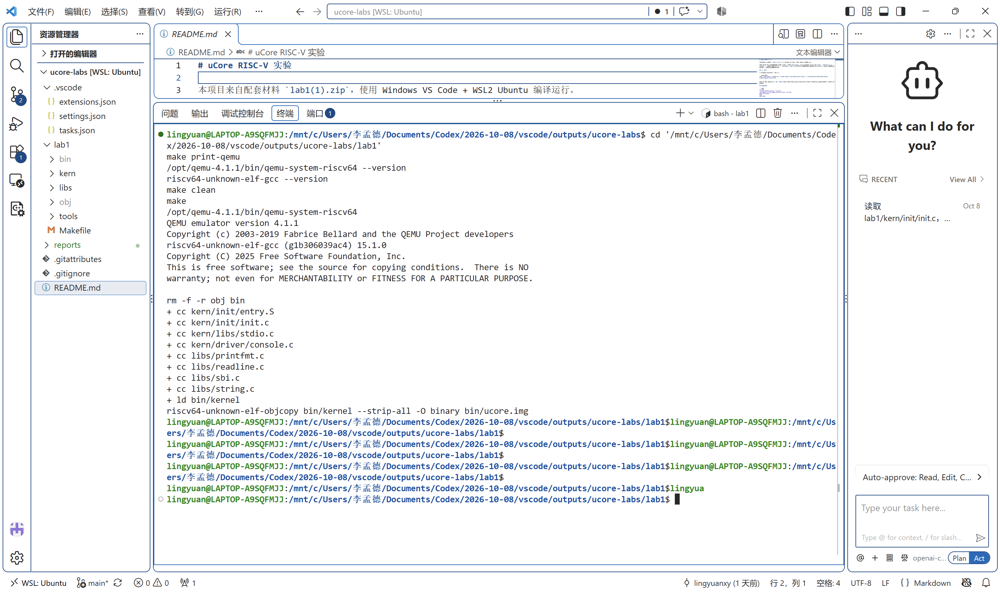
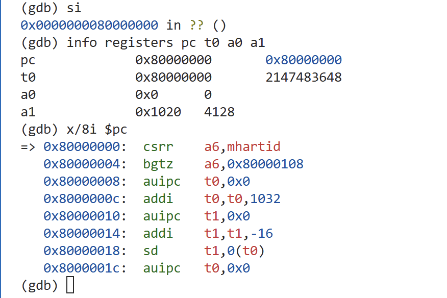
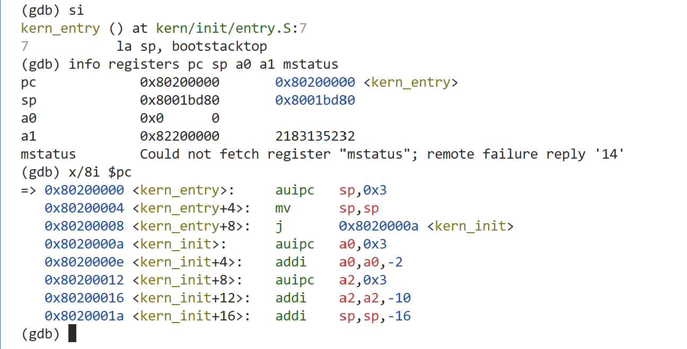
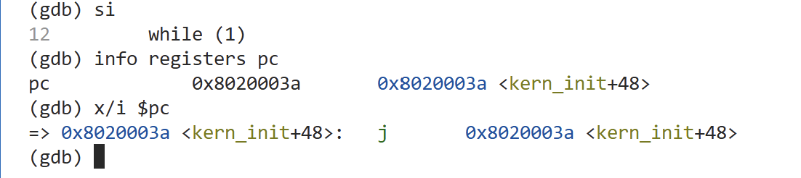
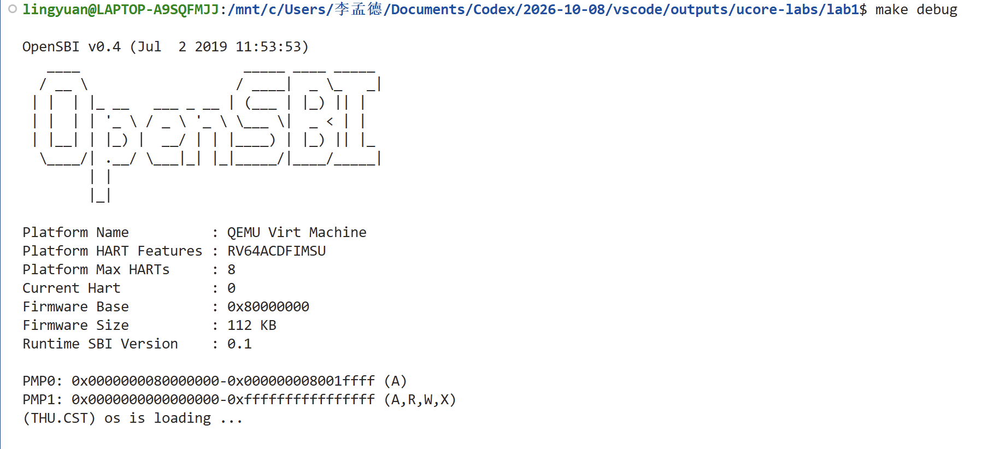

# 操作系统实验报告

## 实验基本信息

| 项目 | 内容 |
| --- | --- |
| **实验名称** | Lab 1：比麻雀更小的麻雀（最小可执行内核） |
| **小组成员** | 2413170-李孟德、2412075-朱钟铭 |
| **完成日期** | 2026-10-10 |

### 小组分工

练习如何分工？

| 成员 | 负责的练习/模块 |
| --- | --- |
| 2413170-李孟德 | 练习1、练习2的实际操作与验证；环境配置、编译、GDB 调试及截图取证 |
| 2412075-朱钟铭 | 练习1启动入口与栈设置的原理分析；链接布局及格式化输出链路梳理；相关报告内容补充与核对 |

实验报告如何分工？

李孟德负责实验环境、编译运行、GDB 调试过程、截图证据及实测结果的整理；朱钟铭负责补充练习1的指令原理、内核启动与输出模块关系、已完成任务汇总及相关总结。两人按源码和已有实验记录核对报告，AI 提供步骤指导、原理解释和文字辅助。

本报告由2413170-李孟德、2412075-朱钟铭共同整理。已记录的调试步骤、寄存器观测值和截图来自李孟德的实际操作；朱钟铭的本次补充集中于源码原理分析与报告整理。课程仓库为 [lingyuanxy/ucore-labs](https://github.com/lingyuanxy/ucore-labs)。实验报告依据课程网站的 [Lab 1 练习](http://oslab.mobisys.top/lab2026/_book/lab1/lab1_2_1_exercise.html) 整理。

### 已完成任务汇总


| 已完成任务 | 完成内容 | 分工与依据 |
| --- | --- | --- |
| 练习1：启动入口指令分析 | 解释 `la sp, bootstacktop` 加载栈顶地址、`tail kern_init` 交接控制权，以及先建立栈再进入 C 函数的原因 | 朱钟铭补充原理与报告；李孟德单步验证，见 E11－E12 |
| 练习2：GDB 验证启动流程 | 记录初始 PC=0x1000、复位指令、OpenSBI 入口及 `mret` 后进入 0x80200000 的过程 | 李孟德调试与取证，见 E02－E10 |
| 内核链接与加载关系梳理 | 核对 `kernel.ld` 的入口、基址和段布局，解释 ELF、原始镜像及 QEMU loader 的关系 | 朱钟铭补充源码分析；编译记录见 E01 |
| 初始化与格式化输出链路分析 | 梳理 `kern_init`、零初始化区间及 `cprintf` 到 SBI 字符服务的调用关系，结合记录说明本次零长度 `memset` 与最终循环 | 朱钟铭补充模块关系；李孟德运行验证，见 E13－E17 |
| 实验报告整理 | 补齐两位成员信息和分工，汇总两项练习、模块分析、验证结果及实验收获 | 李孟德整理实测过程与证据；朱钟铭补充原理说明和完成任务汇总 |

---

## 一、实验目的

本实验的主要目的是：

1. 理解最小可执行内核的内存布局、入口设置，以及链接地址、加载地址和启动入口之间的关系。
2. 使用交叉编译工具生成 RISC-V ELF 内核和原始二进制镜像。
3. 用 GDB 观察 QEMU virt 平台从复位、进入 OpenSBI 到执行内核第一条指令的过程。
4. 理解启动栈、C 入口初始化，以及基于 OpenSBI 服务实现格式化输出的模块关系。

---

## 二、实验环境

你们使用的 AI 工具

| 成员 | AI 编程工具 | 底层模型 | 备注 |
| :--- | :--- | :--- | :--- |
| 2413170-李孟德 | Codex（桌面应用） / Cline（VS Code 插件） | gpt6.1 Sol | Codex 用于实验指导和报告协作；Cline 用于环境配置与源码阅读 |
| 2412075-朱钟铭 | Codex（本次报告协作） | gpt6.1 Sol | 用于源码分析、任务汇总和报告补充 |

**说明：**

- **AI 编程工具**：指具体使用的终端工具、编辑器插件、桌面应用或浏览器界面。
- **底层模型**：指该工具使用的大语言模型及版本。

**实验平台与开发环境（李孟德本机）：**

| 项目 | 本次环境 |
| --- | --- |
| 开发方式 | Windows VS Code＋WSL2 Ubuntu |
| Ubuntu | 26.04，x86_64 |
| 交叉编译器 | riscv64-unknown-elf-gcc 15.1.0 |
| 模拟器 | QEMU 4.1.1，`/opt/qemu-4.1.1/bin/qemu-system-riscv64` |
| 平台 | QEMU virt，64 位 RISC-V |
| 固件 | QEMU 4.1.1 配套 OpenSBI v0.4，Runtime SBI Version 0.1 |
| 调试器 | riscv64-unknown-elf-gdb，GNU GDB 16.3.90.20250610-git |
| 实验目录 | 本仓库的 `lab1`，对应课程材料中的 `labcodes/lab1` |

本实验 Makefile 使用独立路径选择 4.1.1。本人同时核对 `make print-qemu` 和该路径的 `--version`，确认实际版本。
---

## 三、实验整体逻辑分析

### 2.1 本章节的逻辑主线

本章构建的是能够输出启动文字的最小内核。首先让代码位于固件预期的地址，再建立执行 C 函数所需的栈，使用固件提供的字符输出服务逐层封装出格式化输出，最后通过编译和调试验证这些部分能够连成完整的启动过程。

本人实际观察的执行链条如下：

```text
0x1000：QEMU MROM 复位代码
    → 0x80000000：OpenSBI 固件
    → 0x80005036：固件中的 mret，mepc=0x80200000、MPP=1
    → 0x80200000：kern_entry，设置内核启动栈
    → 0x8020000a：kern_init，调用 memset 和 cprintf
    → 0x8020003a：跳向自身的无限循环
```

本次运行命令使用 `-bios default` 和 `-device loader,file=bin/ucore.img,addr=0x80200000`。按照教材的 [内存布局说明](http://oslab.mobisys.top/lab2026/_book/lab1/lab1_3_1_layout.html) 及实际参数，OpenSBI 和内核镜像由 QEMU 在目标 CPU 执行启动指令前装入内存；OpenSBI 随后进行初始化并向内核交接执行权。本次不把它描述为固件运行时从硬盘读取内核的实测过程。

### 2.2 功能的逐步实现

| 顺序 | 功能或模块 | 为什么按这一顺序理解 |
| --- | --- | --- |
| 1 | 链接脚本确定内存布局与入口 | 先明确内核代码和数据的位置，使加载位置与启动入口能够对接 |
| 2 | 汇编入口预留并设置启动栈 | C 函数调用需要栈空间，先设置 sp 再进入 C 代码 |
| 3 | C 入口组织初始化、输出和循环 | 给出最小内核的可见行为，并明确对基础库的需求 |
| 4 | 从 SBI 字符服务向上封装输出 | 内核不能直接依赖宿主 Ubuntu 的运行时库，需要自己的输出路径 |
| 5 | Makefile 编译、链接、生成镜像 | 将不同模块组合为可加载、可执行的内核 |
| 6 | QEMU 和 GDB 验证 | 用寄存器、机器指令和实际输出检查前面的设计是否一致 |

---

## 四、实验内容与实现

### 功能模块：最小可执行内核的启动与格式化输出

**负责人：** 2413170-李孟德（编译运行、调试与取证）；2412075-朱钟铭（启动、链接与输出链路的原理梳理及报告补充）。

#### 模块功能描述

**需要实现/修改的函数：**

本实验阅读和验证课程已有实现，无需新增函数或修改 C/汇编代码。按照模板，列出本模块涉及的主要函数签名：

```c
int kern_init(void) __attribute__((noreturn));
void *memset(void *s, char c, size_t n);
int cprintf(const char *fmt, ...);
uint64_t sbi_call(uint64_t sbi_type, uint64_t arg0,
                  uint64_t arg1, uint64_t arg2);
void sbi_console_putchar(unsigned char ch);
void cons_putc(int c);
```

**功能说明：**

| 模块或函数 | 作用及与其他模块的关系 |
| --- | --- |
| tools/kernel.ld | 设置 OUTPUT_ARCH、ENTRY(kern_entry) 和 BASE_ADDRESS=0x80200000，组织 text、rodata、data、sdata、bss，定义 edata 与 end。ALIGN(0x1000) 按 4096 字节对齐 |
| Makefile、tools/function.mk | 编译和汇编源文件，调用 ld 链接为 bin/kernel，再由 objcopy 生成 bin/ucore.img；QEMU 使用外部加载地址装入原始镜像，GDB 使用 ELF 的符号与调试信息 |
| kern_entry | 设置启动栈，向 kern_init 交接控制权，为 C 代码建立基本执行条件 |
| kern_init、memset | 通过链接符号计算零初始化区间，随后打印启动文字并停在循环中；本次 edata=end，因此 memset 处理零个字节 |
| sbi_call、sbi_console_putchar | 使用本实验的 legacy SBI 约定，把服务号放入 a7、参数放入 a0 等寄存器，经 ecall 请求机器模式固件服务；字符输出服务号为 1 |
| cons_putc、cputch | 把控制台字符输出连接到 SBI 服务，并维护格式化输出计数 |
| cprintf、vcprintf、vprintfmt | 获取可变参数、解析格式串，把输出拆成字符交给回调，最终形成屏幕上的启动文字 |

本实验使用项目自己的 stdio.h、string.h 及对应函数，运行时不依赖宿主 Ubuntu 的 glibc。其输出路径为：

```text
cprintf → vcprintf → vprintfmt → cputch
→ cons_putc → sbi_console_putchar → sbi_call → ecall → OpenSBI
```

链接、加载和交接三者需要一致：链接脚本以 0x80200000 组织内核，QEMU loader 把镜像放到此处，固件把此地址写入 mepc 后执行 mret。该地址属于本实验的软件与平台约定，并不是 RISC-V 指令集对所有内核的固定要求。

#### 最终提示词

根据 Lab 1 实验指导书和本人的学习需求，整理实验指导提示词如下：

```text
请依据课程Lab 1“比麻雀更小的麻雀（最小可执行内核）”
实验指导书，引导我完成实验，并协助我理解原理和撰写报告。

我使用Windows VS Code＋WSL Ubuntu，实验要求使用QEMU 4.1.1，
目标架构为64位RISC-V。我是操作系统初学者，请先解释涉及的
基础概念，再指导操作。实验步骤由我亲自执行。

一、练习1：理解内核启动入口

结合kern/init/entry.S，解释：
1. la sp, bootstacktop完成什么操作，为什么进入C函数前需要设置栈。
2. tail kern_init如何交接控制权，与普通函数调用有什么区别。
3. 启动栈如何预留，sp如何变化，以及汇编入口与kern_init的关系。

结合源码和实际反汇编解释伪指令的展开，避免把某次构建的
地址或指令形式当成所有环境都相同的结果。

二、练习2：使用GDB验证启动流程

指导我使用两个WSL终端启动QEMU调试服务并连接GDB，
跟踪CPU从复位地址0x1000开始，经过OpenSBI，直到到达
内核入口0x80200000并观察第一条内核指令。

逐步说明：
1. 最初几条指令的位置、功能及执行前后的寄存器变化。
2. OpenSBI如何准备内核入口、启动参数和目标特权级。
3. PC、mepc、mstatus.MPP和mret在交接中的作用。
4. 如何选择断点，区分内核加载与CPU开始执行内核。
5. 本实验中QEMU预加载镜像的方式，以及它与指导书
   watch提示的适用关系。

三、指导方式与报告整理

每次只指导一个阶段，给出操作位置、命令、操作目的和需要
观察的结果。等待我反馈输出或截图后，再分析并继续。

补充解释链接脚本、ELF与原始镜像、零初始化和格式化输出
链路，使我理解各模块怎样配合完成启动。

协助我按课程报告模板整理练习答案、调试过程和实验收获。
区分实际观察与源码分析，保留真实的错误和异常现象，
不虚构操作、测试结果或代码生成迭代过程。

```

#### 实现迭代过程

本实验的代码生成迭代次数不适用。这里按模板记录实际调试和报告修正过程，不虚构函数实现次数。

**遇到的问题：**

1. **进入 S 模式后无法读取 mstatus。** QEMU 4.1.1 的调试 CSR 访问仍检查当前特权级，读取失败返回 remote failure reply '14'。本人保留了错误，不虚构执行后的 mstatus 值；地址交接由 PC 与源码定位证明，特权级变化结合执行前 MPP=1 和 mret 语义分析。[QEMU CSR 检查](https://github.com/qemu/qemu/blob/v4.1.1/target/riscv/csr.c)。
2. **sp 的同地址符号注释。** bootstacktop 与紧接栈区域的数据对象 SBI_CONSOLE_PUTCHAR 同为 0x80203000，GDB 选择后者作注释。符号表和栈顶查询确认 sp 正确，栈区上边界与后续数据对象的起点不构成栈内容重叠。
3. **memset 中 n 显示为 2^64-1。** O2 构建的 DWARF 在入口附近用 a2-1 重建源码变量 n，与后置递减相联系。真实入参由 a2=0 和边界差值共同确认，入口 beqz 走返回路径，不能把优化后的源码变量显示当作真实填充长度。[GDB 优化代码说明](https://sourceware.org/gdb/current/onlinedocs/gdb.html/Optimized-Code.html)。

固件内部的设备树搬移及打印服务路径通过源码分析理解，未逐条单步这些内部过程。本人观察到设备树参数从进入固件时的 0x1020 变成交接前的 0x82200000，与当前 OpenSBI 配置和复制逻辑一致。

**问题解决策略：**

保留实际截图，核对寄存器、机器指令、符号表和源码。环境版本按实际输出修正，调试读取失败与优化变量显示分别分析，不以示例输出替代本人结果。

**最终结果：**

- 编译完成，生成 ELF 内核及镜像。
- 两项练习的关键指令和控制权交接已由本人验证。
- QEMU 实际输出启动文字，最终自跳转行为符合源码。

**关键改进点总结：**

用寄存器与控制流核对源码解释，并区分直接单步观察和源码分析。没有将零长度 BSS 写成非空区域清零，也没有把未执行的命令或评分脚本写成测试通过。

**补充观察记录：**

进入 kern_init 后，本人查询到 edata=end=0x80203008。memset 调用前 a0=该地址、a1=0、a2=0，sp 从启动栈顶减 16 到 0x80202ff0。执行 jal 后 ra=0x80200026；finish 后返回该地址，返回值为起始指针 0x80203008。因此本次是正常的零长度调用，不描述为清零了非空内存。

打印前 a0=0x802004c8，指向格式串 `%s\n\n`；a1=0x802004a8，指向启动消息。ni 运行 cprintf 至返回后，PC=0x8020003a。本人再次执行 si，PC 仍为此地址，反汇编为跳向自身的指令，验证了 while(1)。QEMU 终端实际显示 `(THU.CST) os is loading ...`。

**AI 协作方式：**

本人采用“AI 解释一个阶段 → 本人执行 → 回传截图 → 核对并修正”的方式。实验步骤、关键观测和问题处理已整理在本报告正文中；本实验没有函数代码生成任务。李孟德使用的底层模型按其提供的信息填写为 gpt6.1 Sol。朱钟铭本次通过 Codex 补充成员信息、源码原理与任务汇总，个人实验期间使用的其他工具和模型未单独提供。

---

### 练习：练习1——理解内核启动中的程序入口操作

**负责人：** 2412075-朱钟铭（指令原理分析与报告补充）；2413170-李孟德（GDB 单步验证与截图）。

#### `la sp, bootstacktop` 的操作与目的

这条伪指令将符号 `bootstacktop` 的地址装入栈指针 sp，而不是读取该地址处的数据。栈空间由入口文件中的 `.space KSTACKSIZE` 预留；执行 la 是设置栈指针，不是在运行时申请一块堆内存。

源码预留两页启动栈，共 8192 字节。本次构建中 bootstack 位于 0x80201000，bootstacktop 位于 0x80203000，栈使用区间为 `[0x80201000, 0x80203000)`，从高地址向低地址增长。设置后可以为函数调用、返回地址保存及局部数据提供内核自身的栈，避免继续沿用固件留下的栈指针。

本人查询到 bootstacktop=0x80203000。该伪指令在本次构建中展开为：

```asm
0x80200000: auipc sp,0x3
0x80200004: mv    sp,sp
```

两次 si 后，PC 分别为 0x80200004、0x80200008，sp 均为 0x80203000，与栈顶符号一致。第二条对应零偏移，所以没有改变 sp 的数值。

#### `tail kern_init` 的操作与目的

这条尾调用伪指令将控制权交给 C 入口 kern_init，不为本次调用另设返回地址。在本次构建中，它被简化为：

```asm
0x80200008: j 0x8020000a <kern_init>
```

本人单步后 PC 到达 0x8020000a，sp 保持 0x80203000。它的目的，是在栈准备完成后进入 C 初始化代码，继续完成内核启动。kern_init 被声明为 noreturn，末尾存在无限循环，因此此入口不需要等待它返回。

---

### 练习：练习2——使用 GDB 验证启动流程

**负责人：** 2413170-李孟德。

#### 调试方法

在 VS Code 中使用两个 WSL 终端：第一个在 lab1 运行 make debug，第二个运行 make gdb。QEMU 的 `-S` 使 CPU 在开始执行前暂停，`-s` 开启 localhost:1234 的调试服务；GDB 读取 bin/kernel 的符号信息并连接该服务。

本人首先执行：

```gdb
info registers pc
x/8i $pc
```

然后以 si 逐条执行复位代码，配合 info registers、x/i 和 x/1gx 观察寄存器与内存。进入固件后，先观察 hart 分支，再在内核交接指令前设置硬件断点，以避免逐条跟踪全部固件初始化。

#### 最初的指令位于什么地址、完成什么功能？

本实验 QEMU virt 平台的初始 PC 为 **0x1000**，最初执行的是 QEMU MROM 中的复位代码。OpenSBI 的入口位于后续的 0x80000000；0x1000 不是所有 RISC-V 实现统一规定的复位地址。

| 地址与指令 | 主要功能 | 本人实际结果 |
| --- | --- | --- |
| 0x1000：auipc t0,0x0 | 获得当前位置作为地址计算基准 | t0 从 0 变为 0x1000，PC=0x1004 |
| 0x1004：addi a1,t0,32 | 准备设备树地址 | a1=0x1020，PC=0x1008 |
| 0x1008：csrr a0,mhartid | 准备当前 hart 编号 | a0=0，PC=0x100c |
| 0x100c：ld t0,24(t0) | 从 0x1018 读取固件跳转目标 | 内存内容与加载后的 t0 均为 0x80000000，PC=0x1010 |
| 0x1010：jr t0 | 将控制权交给 OpenSBI | PC 到达 0x80000000，a0=0、a1=0x1020 |

这几条指令主要准备启动参数、取得固件入口地址，并执行跳转，而不是完成全部硬件初始化。初次把附近内存反汇编时出现的 unimp 包含对数据的解释；0x1018 实际存放跳转地址，CPU 通过 jr 跳走，不会顺序执行这些数据。

#### 从 OpenSBI 到内核第一条指令

固件入口先读取 hart 编号到 a6，再执行条件分支。本人观察到 a6=0，因此 PC 从 0x80000004 顺序到达 0x80000008，进入主启动路径。

根据当前配套固件的反汇编定位到 mret 后，本人执行：

```gdb
x/i 0x80005036
hbreak *0x80005036
continue
info registers pc mepc mstatus a0 a1
x/i $pc
```

| 交接前状态 | 实际值 | 分析 |
| --- | --- | --- |
| PC | 0x80005036，指令为 mret | 停在交接指令执行前 |
| mepc | 0x80200000 | 下一阶段执行入口 |
| mstatus.MPP | 1 | mret 将选择 S 模式 |
| a0 | 0 | 传给内核的 hart 编号 |
| a1 | 0x82200000 | 传给内核的设备树地址 |

随后执行一次 si，PC 实际变为 **0x80200000 `<kern_entry>`**，GDB 显示入口源码的 `la sp, bootstacktop`，第一条机器指令为 `auipc sp,0x3`。这直接验证了固件到内核第一条指令的控制权交接，满足练习2的观察终点。

本次使用交接前硬件断点和单步，而没有执行教材提示中的 watch 命令，也未把未执行的命令写成实验记录。0x80005036 是当前固件二进制中的地址；固件版本变化时应重新定位。

---

### Challenge：不适用

**负责人：** 无

本次正式任务书没有单独的 Challenge 编程任务。现代笔记本启动流程的拓展理解说明如下：

一般冷启动可以概括为 UEFI 固件、引导管理器或加载器、操作系统内核的逐级交接。与本实验相同之处，是内核执行前需要先准备环境并交接控制权；差异在于本实验由 QEMU 预加载镜像，未验证真实 PC 从存储设备及文件系统查找内核的过程，设备初始化范围也更小。

---

## 五、测试与验证

| 验证项 | 实际结果 | 证据编号 |
| --- | --- | --- |
| 版本与编译 | QEMU 4.1.1，GCC 15.1.0，生成 ELF 与镜像 | E01 |
| 复位入口与五条指令 | 初始 PC=0x1000；参数准备及跳转逐条验证 | E02－E07 |
| 固件入口分支 | hart=0，条件分支顺序前进 | E08 |
| 固件交接 | mret 前 mepc=0x80200000、MPP=1；单步到 kern_entry | E09－E10 |
| 内核栈与 C 入口 | sp=bootstacktop=0x80203000；进入 kern_init | E11－E12 |
| 零长度初始化调用 | edata=end，a2=0；memset 正常返回 | E13－E14 |
| 格式化输出与循环 | 参数字符串正确，调用返回后执行自跳转 | E15－E16 |
| 实际启动输出 | OpenSBI v0.4 与内核启动文字实际出现 | E17 |

**测试截图：**

证据 E01－E17 对应 images 目录中以 01－17 开头的截图文件。正文展示关键截图，其余截图保留在同一目录供核对。

**E01：版本核对与重新编译。**



**E02：初始 PC 与复位代码。**


**E07：逐条执行复位代码后进入 OpenSBI。**



**E09：执行 mret 前的目标地址、目标模式与参数。**


**E10：单步到内核第一条指令。**



**E11：启动栈设置结果。**


**E16：执行自跳转后 PC 不变。**



**E17：QEMU 终端的实际启动输出。**



本次正式练习以源码解释和 GDB 启动观察为验证方式，未要求以 make grade 结果证明完成。本人未在实验操作中运行评分脚本，也不把已有截图描述为评分脚本通过。

---

## 六、实验总结与收获

### 对操作系统的理解

1. **本实验重要知识点及与 OS 原理的对应**

| 重要知识点 | 本实验中的对应 | 含义、关系与区别 |
| --- | --- | --- |
| 启动与控制权交接 | MROM、OpenSBI、kern_entry、kern_init | PC 和跳转指令连接各阶段；0x1000 是本平台的复位地址 |
| 特权级与底层服务 | M 模式固件、S 模式内核、SBI ecall | 硬件权限分层与服务接口体现分工；本次没有运行 U 模式应用 |
| 程序布局与加载 | 链接脚本、ELF、原始镜像、loader | 链接确定布局，加载放置字节，启动选择入口；本实验尚未建立复杂虚拟地址空间 |
| 栈与调用约定 | sp、ra、参数寄存器、jal 和返回 | 支持 C 函数执行；单一启动栈不等同于多任务栈或上下文切换 |
| 静态存储初始化 | edata、end 与 memset | 零初始化由启动代码完成；本次区间为空，实际没有非空 BSS 清零证据 |
| 调试与验证 | 寄存器、反汇编、源码和终端输出 | 需综合证据判断运行行为，区分优化后变量显示和实际参数 |

2. **OS 原理中重要、但本实验没有对应上的知识点**

操作系统中的进程调度、用户进程系统调用、页表与虚拟内存管理、文件系统和并发同步都很重要，但本次最小内核没有实现这些功能。S 模式内核向 SBI 发起 ecall，也不等同于用户程序向内核发起系统调用。

### AI 协作开发的经验

逐阶段操作和截图反馈，使解释能够围绕实际证据展开。报告中的 GCC 版本从预填值修正为实测值，BSS 长度按零填写，而不是照搬示例结果。

遇到寄存器读取失败或优化变量显示异常时，先保留现象，再结合源码、寄存器与指令分析。AI 提供指导和资料核对，本人执行并取证；报告明确区分直接观察与源码分析，不把未执行的 watch 命令或固件内部逐条调试写成已完成过程。

本实验建立了从复位到最小内核可见输出的完整理解框架，为后续中断、内存管理和进程实验提供调试基础。

---
