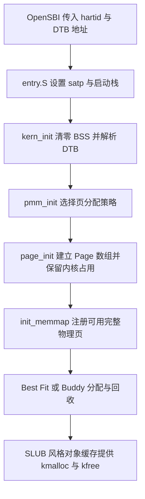

# Lab2：物理内存和页表

| 项目 | 内容 |
| --- | --- |
| 小组成员 | 2413170-李孟德、2412075-朱钟铭 |
| 实验日期 | 2026-10-22 |
| 代码基础 | 用户提供的 `lab2.zip`，内部目录 `lab2_new`，共 39 个文件 |
| 已完成内容 | 物理内存初始化、First Fit 分析、Best Fit、Buddy System、SLUB 选做、内存探测思考题、QEMU/GDB 地址翻译调试 |
| 本次验证方式 | Codex 在本机 WSL 中执行真实编译、QEMU 启动和 GDB 自动化调试，原始输出保存在 `evidence/` |

本文根据本次实际代码和验证日志整理，小组分工暂留空白，后续更新。

### 小组分工

| 成员 | 代码与实验分工 | 报告分工 |
| --- | --- | --- |
| 2413170-李孟德 |  |  |
| 2412075-朱钟铭 |  |  |

## 1. 实验目标与整体逻辑

实验围绕“建立地址映射后，如何把真实 RAM 变成可分配的物理页，再把物理页变成小对象”展开。



内核在进入 C 代码以前，就已启用框架预置的 Sv39 映射。`page_init()` 建立的是物理页管理元数据，不负责在本次实验中动态创建多级页表。硬件地址翻译与物理页分配是相关但不同的两件事。

`pmm_manager` 把公共机制与策略分离：`pmm.c` 统一调用函数指针，Best Fit 和 Buddy 分别提供相同接口。默认选择 Best Fit，`make PMM=buddy` 切换 Buddy；两种构建的对象文件和镜像分开存放。

## 2. 环境与复现

| 工具 | 本机实测 |
| --- | --- |
| 运行环境 | Windows + WSL2 Ubuntu |
| 交叉 GCC | `riscv64-unknown-elf-gcc` 15.1.0 |
| 来宾 GDB | RISC-V GDB 16.3.90.20250610-git |
| 宿主 GDB | Ubuntu GDB 17.1 |
| QEMU | 4.1.1，OpenSBI v0.4 |
| 默认 RAM | 从 DTB 读取到 128 MiB |
| 编译参数 | 框架 `-O2 -g -Wall -Werror` |

机器相关路径放在不纳入 Git 的 `Makefile.local` 中；`Makefile.local.example` 提供配置示例。本机复用实验一的工具链，无需重装。

在 WSL 终端进入仓库的 `lab2` 后执行：

```bash
make
make qemu
# QEMU 退出：Ctrl+A，松开后按小写 x
make grade
make PMM=buddy
make PMM=buddy qemu
python3 tools/run_checks.py
python3 tools/trace_mmu.py
```

`make grade` 检查默认 Best Fit 构建，输出课程脚本的分数。Buddy 与 SLUB 的额外断言由内核启动执行，不能把课程脚本的 20/20 当成这些扩展的单独评分。

## 3. 功能模块一：物理内存初始化

### 3.1 地址与页描述符

必须区分四个量：

| 量 | 示例与意义 |
| --- | --- |
| 物理地址 PA | `0x80200000`，内核镜像加载位置 |
| 虚拟地址 VA | `0xffffffffc0200000`，同一位置的内核虚拟地址 |
| 物理页号 PPN | `PA >> 12`，是绝对页号 |
| 描述符指针 | `&pages[PPN - nbase]`，指向管理该页的 `struct Page` |

映射关系为 `VA = PA + va_pa_offset`，偏移量是 `0xffffffff40000000`。`nbase = 0x80000000 / 4096 = 524288`，因此 `pages[0]` 描述从 `0x80000000` 开始的物理页。

`npage` 是管理上界的绝对页号，不能直接作为描述符数组元素数量。默认 128 MiB 时 `npage = 0x88000000 >> 12 = 557056`，数组实际包含 `npage - nbase = 32768` 个描述符。

### 3.2 page_init 的实现

1. 查询 DTB 的 RAM 基址和长度，检查空区间、加法溢出和本框架支持的起始地址。
2. 设置 `va_pa_offset`，把管理上界限制为 DTB 结束地址和 `PHYSICAL_MEMORY_END` 的较小值，并向下按页对齐。
3. 将链接脚本的 `end` 向上按页对齐，得到 `pages` 的虚拟地址；检查数组能否装入实际 RAM。
4. 初始化全部描述符，先标记为 reserved，清零引用计数和 property。
5. 将描述符数组结束地址转换为 PA 并向上对齐；只有剩余至少一整页时才调用 `init_memmap()`。

先全部保留、再释放真正空闲部分，可以避免把 OpenSBI、内核镜像和 `Page` 数组误交给分配器。向下对齐管理上界是为了舍弃不完整的末页，向上对齐空闲区起点是为了保护仍被占用的首页。

默认构建实测，见 [启动日志](evidence/boot-best_fit-128M.txt)：

```text
physical memory: [0x0000000080000000, 0x0000000088000000)
managed memory end: 0x0000000088000000, npage: 557056
Page descriptors: VA 0xffffffffc0207000, PA 0x0000000080207000, bytes 1310720
free physical memory: [0x0000000080347000, 0x0000000088000000)
```

`sizeof(struct Page)` 在本构建中为 40 字节，`32768 × 40 = 1310720`，即 320 页。空闲区共有 `(0x88000000 - 0x80347000) / 4096 = 31929` 页。

### 3.3 思考：OS 事先不知道可用物理内存怎么办

由固件或引导程序提供硬件描述，而不是盲目读写未知地址探测。在本实验的 QEMU virt 平台，平台生成 DTB，OpenSBI 把其物理地址放在 `a1`，内核从 `memory` 节点的 `reg` 属性读取 RAM 范围。框架只实现了简化的单区间解析。

其他平台可以使用 UEFI 内存映射、传统 x86 BIOS E820 等接口。通用系统还需解析多个 RAM 区间、保留区、MMIO 和设备树保留项；可用内存不能只由一个“起点+总长度”概括。当前实现不支持任意起点、内存空洞和内存热插拔。

## 4. 功能模块二：连续物理页分配

### 4.1 First Fit 的过程与改进

原框架的 `default_pmm.c` 保持不变。

| 函数 | 核心作用 |
| --- | --- |
| `default_init` | 初始化空闲块双向链表和空闲页数 |
| `default_init_memmap` | 清除可用页的 reserved 状态，建立块首描述符，按地址加入链表 |
| `default_alloc_pages` | 从低地址开始找到第一个足够大的空闲块；按请求分配，剩余部分重新入链 |
| `default_free_pages` | 清理回收页的状态，按地址插入，再与前后物理相邻块合并 |

空闲链表只保存每块的首描述符，块长保存在首描述符的 `property`。`PG_property` 表示“这是空闲块的头”，不能当成每一页都有的通用空闲标志。

First Fit 遍历最多 B 个空闲块，搜索为 O(B)。地址有序使邻块合并容易，但低地址容易积累小碎片。可考虑 next-fit 游标减少反复从表头搜索，或使用分桶、平衡树和位图加速检索。不同索引会改变时间、元数据和碎片之间的取舍，不能保证某策略始终最好。

### 4.2 Best Fit 的实现与改进

实现位于 `kern/mm/best_fit_pmm.c`，两个框架检查函数逐字保留。

与 First Fit 的核心区别在选块策略：遍历全部空闲块，选“至少 n 页且长度最小”的块。相同长度选先遇到的低地址块，恰好 n 页时可立即停止。分裂、按地址插入和前后合并沿用相同的不变量。

例如，低地址有 6 页空闲块，高地址有 3 页空闲块，请求 2 页：First Fit 选 6 页块，Best Fit 选 3 页块。本实现搜索和释放插入均为 O(B)，只需要常数额外工作空间。

Best Fit 不等于没有碎片：每次选择最贴近请求的块，仍可能制造大量难以利用的小余块。可以增加按大小组织的树或分桶改善搜索，也可以保留地址索引用于合并；两套索引的维护复杂度会上升。应结合真实工作负载比较失败率、搜索开销和碎片。

### 4.3 Buddy System 的实现

新增 `buddy_pmm.c/h`，每一阶链表管理 `2^order` 页块。初始区间可能既不是 2 的幂，也没有按大块对齐，因此从当前位置依次取“能够放入剩余区间且物理页号满足对齐”的最大块。

分配 n 页时向上取整到幂次，从目标阶开始寻找空闲块；找到更高阶块后逐级对半拆分。释放时用下面的关系确定唯一伙伴：

```text
buddy_ppn = page2ppn(base) XOR (1 << order)
```

只有伙伴也空闲、同阶并在管理范围内时才合并，然后继续尝试上一阶。物理相邻不代表是伙伴，例如页号 1 和 2 相邻，但 `1 XOR 1 = 0`，两者不能直接合并为 2 页块。

本实现约定 `alloc_pages(3)` 实际占 4 页，`free_pages(p, 3)` 按同样规则归还 4 页；调用方应以原请求配对释放。`property` 在已分配块首保存实际容量，用于核对释放；已分配块的 `PG_property` 为 0。

分配和释放最多遍历 16 个阶，主要操作为 O(MAX_ORDER)，初始化为 O(N)。Buddy 便于分裂合并，但请求 5 页会占用 8 页，存在内部碎片。接口不能任意拆开一个分配结果逐页释放，这一点与 Best Fit 的精确页数接口行为不同。

### 4.4 Buddy 的测试设计

检查函数先向真实分配器借出一个对齐的 32 页块，隔离出从第 2 页开始的 31 页非对齐区间，测试完成后恢复真实空闲链表并归还整个块。

| 测试 | 检验的问题 |
| --- | --- |
| 非对齐 31 页初始化 | 不丢失边缘页，块大小和物理页号满足对齐 |
| 申请 3 页、8 页 | 向上取整、块拆分、计数变化及区间不重叠 |
| 连续申请 31 个单页 | 能穷尽测试区；所有返回地址互异 |
| 耗尽后再申请、超大请求 | 返回 NULL，失败不修改计数 |
| 单独归还相邻非伙伴页 | 不能仅因相邻就错误合并 |
| 逆序释放后申请 16 页 | 多级合并真正恢复大块 |
| 链表和计数检查 | 每个空闲块状态、双链关系、阶对齐与总页数一致 |
| 恢复真实分配器 | 借出的全部页面被归还，无页数泄漏 |

这些测试同时检验结果和结构不变量，比只检查“能申请一次再释放”更容易暴露伙伴计算、错误合并和计数问题。

## 5. SLUB 风格对象分配（选做）

新增 `slub.c/h`，在 `pmm_init()` 后调用 `slub_init()` 和 `slub_check()`。

底层通过当前 PMM 申请页；上层使用 16、32、64、128、256、512、1024、2048 字节八个大小类。每个 slab 占一页，页内 96 字节头保存大小类、空闲对象链、使用计数和 256 位分配位图。缓存链表只保存尚有空位的 slab。

`kmalloc()` 向上选大小类，从空闲对象链摘一个对象；slab 满时移出 partial 链表。`kfree()` 根据指针所在页定位头部，验证对象边界和分配位图后归还对象；原本满的 slab 重新进入 partial 链表，最后一个对象释放时整页归还 PMM。

大于 2048 字节的对象直接按页申请连续空间，页头记录原始请求页数。Buddy 可能在下层多分配页面，释放仍传原请求页数，避免破坏其配对约定。所有返回指针保证 16 字节对齐，`kmalloc(0)` 返回 NULL，`kfree(NULL)` 无操作，大小加法溢出返回 NULL。

这是体现 SLUB 主体思想的教学简化版本，没有 Linux SLUB 的 per-CPU 快速缓存、NUMA 策略、锁和完整调试设施；当前实验按单 hart 顺序运行。

测试覆盖八类的边界、跨页的大对象、完整请求空间的写入和核对、存活对象不重叠、300 个小对象跨 slab、交错释放和复用、空 slab 回收以及失败不泄漏。全部对象释放后用 `nr_free_pages()` 检查底层空闲页数恢复。测试分别在 Best Fit 和 Buddy 上运行，结果见两种模式的启动日志。

## 6. SPEC 与提示词记录

完整的七份四段式规格见 [SPEC与提示词](SPEC与提示词.md)，包括：物理内存初始化、Best Fit、Buddy 实现、Buddy 测试、GDB 调试、SLUB 实现、SLUB 测试。该文件作为报告配套材料一起提交。

每份都使用课堂插图的 `[PROMPT]`、`[RELY]`、`[GUARANTEE]`、`[SPECIFICATION]` 格式：分别明确任务、可依赖的框架、必须维持的不变量和逐项行为。Buddy 与 SLUB 都把实现规格与测试规格分开，使测试关注行为与边界，而不是简单照抄实现。

这些规格是助手根据手册和源码整理并用于本次实现的任务约束，不是声称用户曾逐字发送过这些消息。用户实际追加的范围要求是“先直接完成所有内容，然后提供一个学习路线给我”。

## 7. GDB 观察 QEMU 地址翻译

### 7.1 调试对象与方法

宿主 x86_64 GDB 调试 QEMU 本身，RISC-V GDB 通过 QEMU stub 调试来宾内核。本机安装目录中的 QEMU 已 stripped，但实验一保留的构建目录可执行文件含 `debug_info`，无需重新编译，也无需替换系统 QEMU。

本次分别启动独立运行来采集宿主页表、宿主 TLB 和来宾寄存器日志。宿主 GDB 从进程启动时就设置条件断点，直接捕获 CPU 对 `kern_init` 的真实取指地址，避免来宾调试器读内存造成额外翻译而混淆来源。这也采用了手册提出的“已知地址条件断点”的简化思路。

脚本 `tools/trace_mmu.py` 读取当前 ELF 符号取得地址，不依赖手工写死 `kern_init`；按关键源码语句定位 PTE 与 TLB 断点。可执行命令和原始输出分别是：

- [宿主页表 GDB 命令](evidence/host-mmu.gdb) 与 [日志](evidence/host-mmu.txt)。
- [宿主 TLB GDB 命令](evidence/host-tlb.gdb) 与 [日志](evidence/host-tlb.txt)。
- [来宾内核 GDB 命令](evidence/guest-kernel.gdb) 与 [日志](evidence/guest-kernel.txt)。

### 7.2 Bare 与 Sv39 的实测

在 S 模式的物理内核入口，`PC = 0x80200000`、`satp = 0`。QEMU 的 `get_physical_address()` 走 Bare 分支，返回相同物理地址。尚未开启分页也会经过 QEMU 的软件 TLB 填充路径，因为它还需要快速定位宿主 RAM，并处理访问属性；不能把这一点误解成真实 CPU 在 Bare 模式也进行了页表遍历。

开启分页后，来宾 `kern_init` 的地址为 `0xffffffffc02000d6`，`satp = 0x8000000000080205`。高 4 位的 MODE 为 8，即 Sv39；低 44 位 PPN 为 `0x80205`，根表 PA 为 `0x80205000`。

真实取指时观察到的关键调用路径为：

```text
tb_htable_lookup
  -> get_page_addr_code
    -> tlb_fill
      -> riscv_cpu_tlb_fill
        -> get_physical_address
        -> PMP 检查
        -> tlb_set_page
```

这是本次捕获的取指路径。普通数据加载还有 `load_helper()` 的路径，不能把取指栈说成所有 load/store 都必经的统一栈。

### 7.3 根表叶项与物理地址计算

| 变量 | GDB 实测 |
| --- | --- |
| `addr` | `0xffffffffc02000d6` |
| `base` | `0x80205000` |
| `levels` | 3 |
| 循环 `i` | 0，表示第一次循环，对应最高 VPN[2] |
| `ptshift` | 18 |
| `idx` | `511 = 0x1ff` |
| `pte_addr` | `0x80205ff8` |
| `pte` | `0x200000cf` |
| `ppn` | `0x80000` |

PTE 地址为 `base + 511 × 8 = 0x80205ff8`。其 V、R、W、X、A、D 置位，U 未置位，是 supervisor 可读、可写、可执行叶项，满足本次取指权限。

根级已经出现 R/X 叶项，所以本次是 1 GiB 大页映射。Sv39 支持三级，只有碰到非叶项才继续向下走；本例没有读取第二级、第三级页表。

```text
物理页基址 = (PTE.PPN | (VPN & ((1 << 18) - 1))) << 12
           = 0x80200000
页内偏移   = 0x0d6
最终 PA    = 0x802000d6
```

需要注意，QEMU 4.1.1 的这个函数返回的是 4 KiB 页基址，日志里的 `*$outpa` 因而是 `0x80200000`，没有直接包含低 12 位。最终访问 PA 还要加回页内偏移，不能把函数打印值与完整物理地址混为一谈。

关键分支依次检验：地址符号扩展是否符合 Sv39、PTE 是否有效、是否为非叶项、R/W/X 组合是否合法、U/S 权限、大页 PPN 对齐、请求访问权限、A/D 位更新，最后组成物理页地址。当前 PTE 已预设 A/D，未触发写回更新。

### 7.4 TLB 未命中和命中

在 `accel/tcg/cputlb.c:get_page_addr_code()` 的查询分支停下：第一次 `entry->addr_code = 0xffffffffffffffff`，目标页是 `0xffffffffc0200000`，二者不匹配；victim TLB 也未命中，调用 `riscv_cpu_tlb_fill()`。

查表成功后，`tlb_set_page()` 实测参数为：虚拟页 `0xffffffffc0200000`、物理页 `0x80200000`、`prot = 7`、`mmu_idx = 1`、`size = 4096`。根表使用 1 GiB 叶映射，而这里按 4 KiB 填入 QEMU 软件 TLB，两种粒度不应混淆。

随后同页代码查询再次到达 TLB 判断处，`entry->addr_code` 与目标页均为 `0xffffffffc0200000`。执行一次 `next` 直接从 1030 行到 1039 行，跳过 refill 分支，记录了真实的命中行为。

TLB 索引计算位于 `include/exec/cpu_ldst.h:tlb_index()`，使用虚拟页号和大小掩码；命中比较在 `include/exec/cpu-all.h:tlb_hit()`。数据加载的 C 慢路径可在 `load_helper()` 中找到相同的查询、victim 查询和 refill 结构；常见数据访存的快路径还可以由 TCG 生成宿主指令完成，因此并非每次访问都能在一个 C 函数入口断住。

QEMU 的软件 TLB 除缓存地址翻译，还缓存宿主 RAM 偏移和 MMIO/访问标志等信息，服务于模拟器加速；其组织方式与具体真实 CPU 的硬件 TLB 不完全相同。命中查询后得到的 `addend` 是宿主映射相关量，不能直接当作来宾物理地址。

### 7.5 调试中的现象与 AI 协助

1. 带 `-g` 的构建目录可执行文件保留符号，但安装目录中的同版本文件已 stripped；先用 `file`、`readelf` 检查，避免无必要重编译。
2. 优化构建中 `ptesize`、`vm` 等局部变量显示 `<optimized out>`。改用仍可观察的 base、idx、pte 和调用参数，而没有为报告编造不可见变量。
3. 在 PTE 移位语句设置的源码断点实际停在下一条有效行，是编译器优化与行号映射的结果。
4. 明确区分 QEMU 返回的页基址与完整物理地址，以及根表 1 GiB 映射与 TLB 4 KiB 填充粒度。
5. 自动化脚本分别运行宿主观察和来宾观察，避免调试器读内存与 CPU 取指互相干扰；来宾会话还记录了两条真实 `stepi` 的 PC 变化。

AI 本次用于任务拆解、实现、生成可重复调试命令和解释实际日志。对代码原理的掌握仍需通过亲自运行与当场解释验证，不能把自动化完成等同于已经学会。

## 8. 验证结果

| 验证 | 结果与证据 |
| --- | --- |
| 课程评分 | `Total Score: 20/20`，见 [grade.txt](evidence/grade.txt) |
| Best Fit，64/128/256 MiB RAM | 三种启动均通过页分配检查与 SLUB 检查 |
| Buddy，64/128/256 MiB RAM | 三种启动均通过 Buddy 结构断言与 SLUB 检查 |
| 256 MiB 的管理上界 | 按框架限制截断到 `0x88000000`；这是额外启动验证，不代表在该配置运行过课程评分 |
| 页表遍历 | 真实捕获 Bare/Sv39、根表叶项、权限分支及物理页地址 |
| TLB | 真实捕获 miss、refill、后续 hit |
| 来宾内核 | 观察物理入口、虚拟入口、satp、PTE 和指令单步 |
| 框架完整性 | `default_pmm.c`、评分脚本、注入脚本、课程测试文件及 Best Fit 两个检查函数保持原样 |

启动日志在内核进入最终循环后由脚本终止 QEMU，因此日志末尾的 SIGTERM 是有意结束模拟器，不是内核崩溃。完整的六份启动输出保存在 `evidence/boot-*.txt`。

本次生成的 C 模块没有出现编译错误或启动断言失败。实际遇到的问题主要是材料读取的 GBK 编码错误（改为 UTF-8）、终端命令变量转义影响状态码检查（改用 Python subprocess 检查真实退出码），以及上述调试符号和地址粒度辨析；没有为了填写报告而虚构算法 bug。

## 9. 与操作系统原理的联系

| 原理知识点 | 本实验体现 | 差异与限制 |
| --- | --- | --- |
| 地址空间和 MMU | satp、Sv39 根表、VA/PA 转换 | 只使用预设内核大页映射 |
| 物理内存管理 | Page 数组、保留页和连续页分配 | 单个 RAM 区间、固定管理上界 |
| 机制与策略分离 | pmm_manager 函数指针 | 教学框架没有完整设备/内存域抽象 |
| 外部碎片 | First Fit、Best Fit 的块拆分与合并 | 尚未实现内存紧缩和页迁移 |
| 内部碎片 | Buddy 幂次取整、SLUB 大小类取整 | 通过加速分配换取部分空间损耗 |
| 分层分配 | 页分配器支撑对象缓存 | 简化 SLUB，无 per-CPU、NUMA 和并发控制 |
| TLB 与局部性 | 首次 miss 后同页查询 hit | QEMU 软件结构不同于具体芯片实现 |

原理课中重要、但本次未实现的内容包括：用户进程独立地址空间、按需分页、缺页处理、页面置换与交换、写时复制、共享页和内存映射文件、ASID 管理、多核 TLB shootdown、并发分配同步及 NUMA 内存策略。

## 10. 资料与提交说明

- [实验二练习与选做](http://oslab.mobisys.top/lab2026/_book/lab2/lab2_2_1_exercise.html)。
- [QEMU/MMU 调试要求](http://oslab.mobisys.top/lab2026/_book/lab2/lab2_4_qemu_mmu_debug.html)。
- [实验报告要求](http://oslab.mobisys.top/lab2026/_book/lab2/lab2_5_labs_requirement.html)。
- [物理内存探测](http://oslab.mobisys.top/lab2026/_book/lab2/lab2_3_5_2_search_phymem_layout.html)。
- 用户提供的 2026-10-13 课堂智能纪要，含四段式 SPEC 图。智能纪要存在误记可能，涉及实现时以手册、源码和实测交叉核对。

按课程要求保留 `lab2` 注释，两个原始 `YOUR CODE` 已替换为学号 2413170。报告、提示词、源码和 evidence 日志应一起纳入小组仓库；`bin/obj` 及个人 `Makefile.local` 不提交。课程纪要记载截止时间暂定 2026-10-26，最终时间需按课程正式通知确认。

个人学习和答辩准备见 [学习路线](学习路线.md)。
