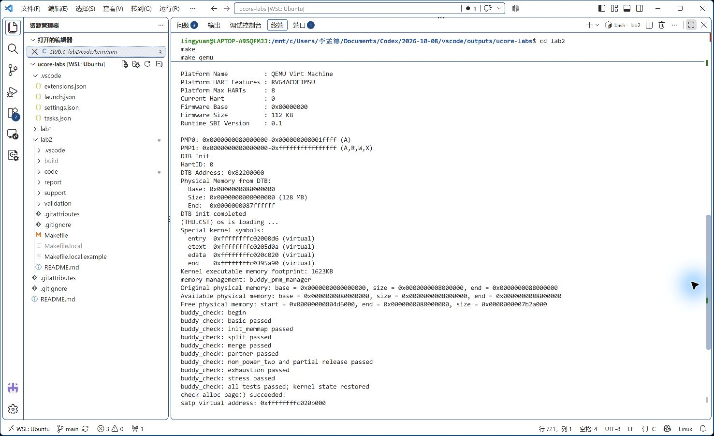
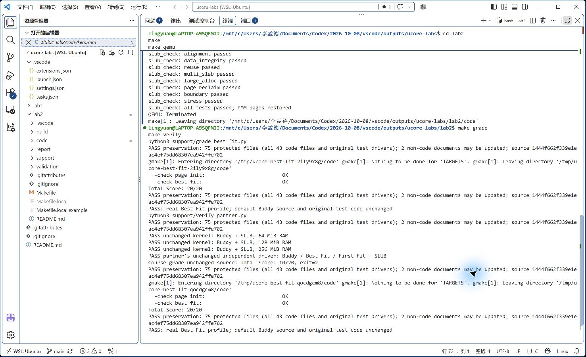
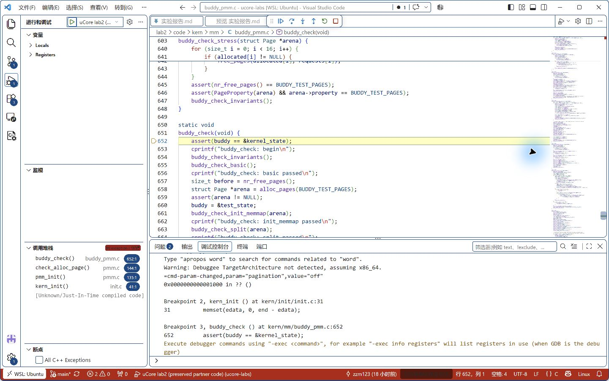
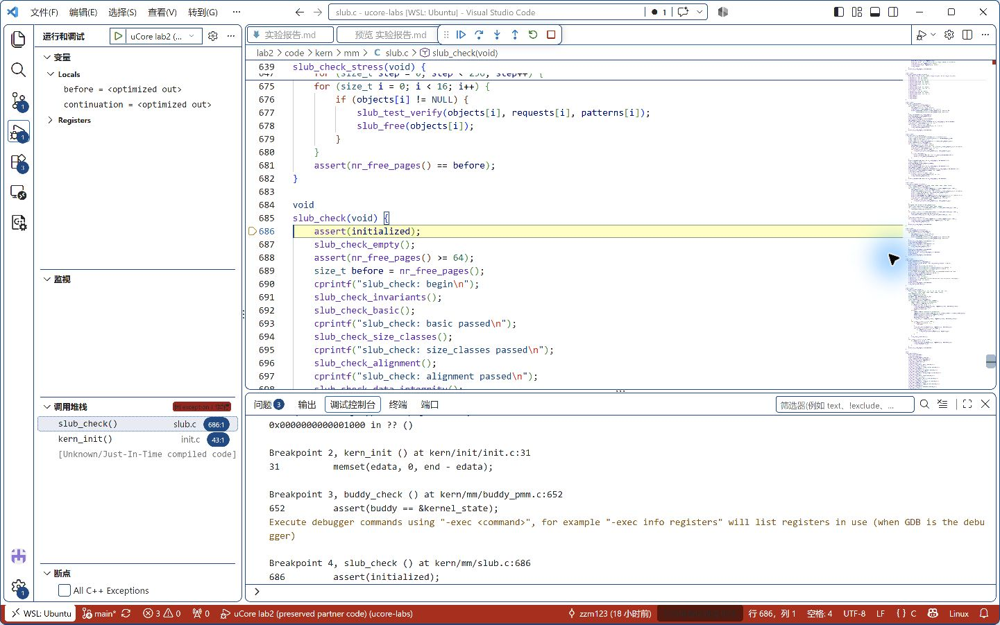

# 操作系统实验报告

## 实验基本信息

| 项目 | 内容 |
| --- | --- |
| **实验名称** | Lab 2：物理内存和页表 |
| **小组成员** | 2413170-李孟德、2412075-朱钟铭 |
| **完成日期** | 2026-10-25 |
| **代码目录** | [code/](code) |

### 小组分工

练习如何分工？

| 成员 | 负责的练习/模块 |
| --- | --- |
| 2413170-李孟德 |  |
| 2412075-朱钟铭 |  |

实验报告如何分工？

| 成员 | 报告分工 |
| --- | --- |
| 2413170-李孟德 |  |
| 2412075-朱钟铭 |  |

分工按要求留空。源码实现依据搭档 `1444f66` 保留；以下实现过程来自原提示词及运行记录，本轮进行报告整理、核验与补充验证。完成情况见下表，测试结果与保留问题集中在第五节。

### 任务完成情况

| 任务 | 完成内容及报告位置 |
| --- | --- |
| 物理内存初始化 | 描述符、占用区排除、对齐和六类输入验证，见 4.1 |
| 硬件探测 Challenge | DTB、固件内存映射与平台信息等方法，见 4.2 |
| First Fit 思考题 | 四个函数、合并条件、改进与参考代码缺陷，见 4.3 |
| Best Fit | 完整实现、原测试保留、独立运行；源码选择器仍为 Buddy，见 4.4 |
| Buddy | 实现与测试两份提示词、整幂分配、部分释放及不变量验证，见 4.5 |
| SLUB Challenge | 两层分配、两份提示词、对象及大对象测试，见 4.6 |
| GDB 分支 | 建表六问、真实查表、TLB、Bare/Sv39 对照与调试思考，见 4.7 |

---

## 一、实验目的

1. 理解设备树提供的 RAM 信息，建立物理页描述符并排除已占用内存。
2. 理解 First Fit，实现并验证 Best Fit、Buddy 的连续物理页分配与回收。
3. 完成 SLUB Challenge，理解页级分配与小对象分配的两层结构。
4. 理解 Sv39 启动映射和 TLB，通过内核及 QEMU 源码调试观察地址转换。
5. 使用有明确前提、约束和检查条件的提示词辅助开发，以真实运行结果验证实现。

---

## 二、实验环境

你们使用的 AI 工具：

| 成员 | AI 编程工具 | 底层模型 | 备注 |
| --- | --- | --- | --- |
| 2413170-李孟德 | Codex | 未单独记录 | 实验解释、报告整理、本机核验 |
| 2412075-朱钟铭 | Codex | 未单独记录 | 原实现、提示词与调试记录 |

两位成员均使用 Codex；具体底层模型及版本未单独记录。

### 2.1 李孟德本机

| 项目 | 实际环境 |
| --- | --- |
| 开发方式 | Windows VS Code + WSL Ubuntu，x86_64 |
| 平台与 RAM | QEMU virt / RV64，默认 128 MiB |
| 交叉编译器 | `/home/lingyuan/riscv-elf-toolchains/bin/riscv64-unknown-elf-gcc`，15.1.0 |
| QEMU | `/opt/qemu-4.1.1/bin/qemu-system-riscv64`，实测 4.1.1 |
| 固件 | OpenSBI v0.4 |
| 客户机 GDB | RISC-V GDB 16.3.90；VS Code 使用 `/usr/bin/gdb-multiarch` |
| 宿主 GDB | Ubuntu GDB 17.1 |
| QEMU 源码调试 | `~/.cache/ucore-qemu/qemu-4.1.1/` 下带符号的独立构建 |
| 个人配置 | `lab2/Makefile.local`，不提交 Git |

版本与当前 ELF 摘要见 [local-environment.json](validation/2026-10-25/local-environment.json)。

### 2.2 搭档历史环境与证据边界

原记录使用 `/home/viewfinder/toolchains/os-freedom-tools/bin/` 下 GCC 10.2.0；标准启动及源码调试使用 `/home/viewfinder/qemu-4.1.1/riscv64-softmmu/qemu-system-riscv64`，实测 4.1.1。其 `/opt/qemu-4.1.1/` 曾实测为 7.0.0，属于搭档当时的安装，不能套用到李孟德本机。

原现场见 [evidence/README.md](report/evidence/README.md)，本机补充见 [验证目录](validation/2026-10-25/README.md)。调试地址随 ELF 和工具链改变，引用时分别标明来源；原文件和课程测试没有随报告修改。

---

## 三、实验整体逻辑分析

### 3.1 本章节的逻辑主线

本实验建立“发现 RAM → 建立每页的管理记录 → 分配与回收连续物理页 → 在页内分配小对象”的资源管理链。页分配器管理物理页归属，页表负责虚拟地址到物理地址的转换，二者解决不同问题。

实际启动链为：

```text
OpenSBI：准备启动参数，a1 指向 DTB
  → kern_entry：准备栈、设置 satp、sfence.vma、切换到内核高地址
  → kern_init：清理 BSS
      → dtb_init：解析并保存 RAM 起点、大小
      → cons_init：初始化控制台
      → pmm_init
          → init_pmm_manager：选择 Buddy，初始化管理器内部状态
          → page_init：建立 pages[]，排除占用区
              → init_memmap：调用当前管理器登记可用页
          → check_alloc_page：运行当前管理器检查
      → slub_init → slub_check
      → 内核现有空闲循环
```

### 3.2 功能的逐步实现

| 顺序 | 功能 | 为什么按此顺序 |
| --- | --- | --- |
| 1 | 启动静态页表、设置 satp | 先让内核高地址及 RAM 可访问 |
| 2 | DTB 读取 RAM 起点与大小 | 先知道物理内存范围 |
| 3 | 选择 PMM，执行 page_init | 建立描述符、排除占用区，登记完整空闲页 |
| 4 | First Fit 分析、Best Fit 实现与检查 | 理解并替换空闲块选择策略 |
| 5 | Buddy 实现与独立测试 | 用按阶拆分、伙伴合并管理连续页 |
| 6 | SLUB 与对象测试 | 基于 PMM 分配小对象、处理大对象和回收 |
| 7 | 双层 GDB 验证 | 从真实指令、QEMU 查表和 TLB 三方面核对地址转换 |

当前默认 PMM 为 Buddy；Best Fit 在独立配置中验证。统一 `pmm_manager` 接口不代表同时让多个分配器管理同一批页面。

---

## 四、实验内容与实现

本节按练习顺序组织，包含硬件探测思考题、SLUB Challenge 和 GDB 分支。负责人字段继续留空。现有记录未保存所有历史迭代次数，因此只列可核对的问题、调整与结果，不虚构次数。

### 4.1 功能模块一：物理内存初始化

**负责人：**

#### 模块功能描述

**需要实现/修改或分析的函数：**

```c
static void page_init(void);
static void init_memmap(struct Page *base, size_t n);
```

本任务补全 `page_init()`；`init_memmap()` 是框架已有转发接口。成功返回时应建立描述符布局和初始空闲区，错误输入按契约终止。

#### 最终提示词

该阶段由原实现者编写，AI 引导审阅。实际提示词包括“帮我核定一下page_init的正误并引导我修改……”“如何检查内存信息是否有效”“pages[] 描述符数组怎么放置？从哪开始放置”。完整关键交互见 [提示词索引](report/prompt.md#一环境配置与-page_init-引导审阅)，没有事后补造一条完整生成提示词。

#### 实现迭代过程

| 阶段 | 问题与调整 | 结果 |
| --- | --- | --- |
| 布局审阅 | 统一 PA/VA，先确定原始末端再裁剪范围 | 避免错误相减与平移末端 |
| 描述符初始化 | 明确数组占用、指针算术和先保留后登记 | 内核与数组不进入空闲区 |
| 验证 | 正常启动、课程检查及六种解析后输入 | 预期成功或错误拒绝均符合记录 |

#### 4.1.1 检查 RAM 范围

`get_memory_base()`、`get_memory_size()` 返回 DTB 解析结果。先用原始起点和大小计算末端，再裁剪区间，避免改变起点后错误地平移整个 RAM 范围。

当前代码检查 RAM 起点不能高于 `KERNEL_BEGIN_PADDR`，将低于 `DRAM_BASE` 的起点提升到 `DRAM_BASE`，将超过 `PHYSICAL_MEMORY_END` 的末端裁剪到该上界，再计算 `mem_size = mem_end - mem_base` 并拒绝空区间或反向区间。后续还检查描述符之后是否有完整空闲页。

需要区分“设备树报告 RAM”和“现在可以分配的 RAM”。`Available physical memory` 这一输出标签实际表示裁剪后的管理范围，其中仍包含内核等占用部分；`Free physical memory` 才是提交给 PMM 的区间。

本轮除默认 DTB 正常路径，还验证了解析后 RAM 输入的零大小、起点过高、无空闲页、末端加法回绕、非对齐末端和低起点裁剪，见 4.1.5。注入发生在解析之后，不等于验证 DTB 解析器对任意畸形字节流的安全性；多个离散内存段、保留节点仍未全面测试。当前实现以本实验的单段 RAM 和固定平台上界为前提。

#### 4.1.2 四类地址与页描述符

| 概念 | 本实验中的含义 |
| --- | --- |
| 物理地址 PA | RAM 中的字节地址，如 `0x804d6000` |
| 物理页号 PPN | `PA / PGSIZE`，不含页内偏移 |
| 内核虚拟地址 VA | 处理器开启分页后使用的地址 |
| `struct Page *` | 指向管理信息的指针，不是对应物理页的数据地址 |

`va_pa_offset` 保存内核直接映射区的固定偏移：

```text
va_pa_offset = KERNBASE - KERNEL_BEGIN_PADDR = 0xffffffff40000000
VA = PA + va_pa_offset
PA = VA - va_pa_offset
```

该关系只适用于当前直接映射范围，不能用于任意用户虚拟地址。

`nbase = DRAM_BASE / PGSIZE` 是起始物理页号，`npage = mem_end / PGSIZE` 是页号上界，因此描述符数量是 `npage - nbase`。`mem_base` 用来解释和裁剪硬件范围；数组下标约定则由框架固定的 `DRAM_BASE` 决定，两者职责不同。不能因为数量公式中没有再次出现 `mem_base`，就认为它没有用途。

```text
pa2page(pa) = pages + (PPN(pa) - nbase)
page2ppn(page) = (page - pages) + nbase
page2pa(page) = page2ppn(page) * PGSIZE
```

`pa2page()` 返回包含该物理地址的页的描述符。通过 `Page *` 找到数据，要先 `page2pa()`，再按直接映射关系转换为内核可访问地址。

`struct Page` 在本次 RV64 构建中大小为 40 字节：

| 字段 | 用途 |
| --- | --- |
| `ref` | 页面引用计数 |
| `flags` | 保留状态、空闲块首页等标志 |
| `property` | 对空闲块首页记录连续块页数；其含义需结合标志判断 |
| `page_link` | 嵌入的双向链表节点，连接空闲块首页 |

管理信息和物理页数据分开，使页面可以完整存放内核数据，也能在不访问或覆盖页内数据的情况下检查空闲状态。`page_link` 保存前后链表节点地址；`le2page()` 借助成员偏移找到所属描述符。链表中一个节点可以代表多页，不是每个空闲页都必须各占一个节点。

#### 4.1.3 描述符布局与初始化

`end` 是链接脚本给出的内核虚拟地址末端，包含 BSS。数组起点向上按页对齐：

```c
pages = (struct Page *)ROUNDUP((uintptr_t)end, PGSIZE);
size_t page_num = npage - nbase;
uint64_t page_array_size = ROUNDUP(page_num * sizeof(struct Page), PGSIZE);
uintptr_t desc_end = (uintptr_t)pages + page_array_size;
uintptr_t free_start = PADDR(ROUNDUP(desc_end, PGSIZE));
uintptr_t free_end = ROUNDDOWN(mem_end, PGSIZE);
```

先确认 `free_start < free_end`，然后遍历 `page_num` 个描述符，清零标志、引用计数和 `property`，初始化链表节点并设置 `PageReserved`。给 `pages` 赋值只确定数组位置，不会自动初始化每个元素。

`pages + page_num` 按元素移动，已经隐含乘以 `sizeof(struct Page)`；`(uintptr_t)pages + byte_count` 才按字节移动。因此 `(uintptr_t)(pages + page_num)` 是正确的未对齐数组末端表达式，不能再乘一次描述符大小。

随后执行：

```c
init_memmap(pa2page(free_start), (free_end - free_start) / PGSIZE);
```

公共函数转发到当前管理器。管理器解除这部分页的保留状态并组织空闲块；OpenSBI、内核镜像、启动页表、静态管理数据和描述符数组仍被排除。

内核占用的 RAM 属于物理内存，但当前不属于可分配的空闲物理内存。描述符需要覆盖这些页，才能统一表示它们的状态，所以描述符数量大于空闲页数。

`page_init()` 不设置 `base->property = n`，因为它负责确定和初始化页面全集；`default_init_memmap()` 才负责把给定空闲区组织成一个块，块首页的 `property = n` 属于分配器自己的表示。Buddy 还可能将同一区间拆成多个不同阶的块。

#### 4.1.4 本次布局的实际核对

完整启动日志给出 RAM `[0x80000000, 0x88000000)`，以下均采用左闭右开区间：

| 项目 | 实际值或由实际值计算的结果 |
| --- | --- |
| 页大小 | `0x1000`，4096 字节 |
| `nbase` / `npage` | `0x80000` / `0x88000` |
| 描述符数量 | `0x8000`，32768 |
| 链接符号 `end` | `0xffffffffc0395a90` |
| `pages` 起点 | `0xffffffffc0396000`，物理地址 `0x80396000` |
| 数组占用 | `32768 × 40 = 0x140000` 字节 |
| 最终空闲区 | `[0x804d6000, 0x88000000)` |
| 初始空闲页数 | `0x7b2a000 / 0x1000 = 31530` |

这里不是把 32768 页全部加入空闲链表。描述符数组本身占用 320 页；其前面的固件、内核等占用也必须排除。Buddy 和测试状态的静态数组已经计入内核 `end`，不会再次被分配。

#### 4.1.5 本轮输入边界实测

在未修改的默认内核上，GDB 停在 `pmm_init()`，仅改变 `dtb_init()` 已缓存的 `memory_base/memory_size`，然后执行真实 `page_init()`。错误用例停在真实 `__panic` 并核对原因；成功用例停在 `buddy_check()` 入口，说明初始化已完成，再检查 `npage`、数组位置、保留标志和实际空闲页计数。

| 用例 | 注入输入或条件 | 实际结果 |
| --- | --- | --- |
| 零大小 | base=`0x80000000`，size=0 | `invalid memory size` |
| 起点过高 | base=`0x80300000`，高于内核物理起点 | `invalid memory base` |
| 无完整空闲页 | base=`0x80000000`，size=`0x300000` | `no free memory available`，未进入分配器自检 |
| 加法回绕 | base=`0x80000000`，size=`UINT64_MAX` | `invalid memory size`；本例通过末端顺序检查拒绝，不声称做了显式溢出检查 |
| 末端非页对齐 | size=`0x7ffffff` | 向下截取完整页，空闲页数与布局推导一致 |
| 下界裁剪 | base=`0x7ff00000`，size=`0x8100000` | 保留原始末端 `0x88000000`，描述符及空闲计数正确 |

命令为 `make -C lab2 audit-page-init`。六份 GDB 脚本、现场输出及 [摘要](validation/2026-10-25/page-init-summary.json)均保存。这是输入契约验证，不是畸形 DTB 全覆盖或不同真实 RAM 硬件的实测。无空闲页时的预期 panic 属于正确拒绝行为。

### 4.2 Challenge：未知硬件的内存范围如何获取

**负责人：**

**问题：** OS 无法提前知道可用物理内存范围时，如何获取？

**实际提示词：** “请回答一下扩展任务 Challenge：硬件的可用物理内存范围的获取方法（思考题）”。

如果 OS 无法预先知道 RAM 范围，首选由固件或引导程序提供硬件内存描述。本实验通过 OpenSBI 传入的 DTB 地址，解析内存节点 `reg` 属性取得 RAM 的起点和长度。

其他平台可通过 BIOS E820、UEFI `GetMemoryMap()`，或引导协议传递的内存映射获得各段地址及其类型。在特定嵌入式平台上，也可由板级程序读取内存控制器配置或按硬件手册提供布局。一般情况下应保存多个区间，并区分普通 RAM、固件保留区、设备地址和内存空洞。

得到 RAM 列表之后，还要扣除内核、固件、页表、描述符、仍需使用的 DTB 等占用，再按页边界整理成空闲区。设备树的保留区信息也应纳入一般实现；当前实验代码主要处理单段 RAM 和固定前缀占用，不能当作通用多区间实现。

不宜通过任意地址试写、读回来普遍探测内存：该地址可能对应 MMIO、触发设备副作用或访问异常。早期系统可以在严格约束下做平台相关探测，但这不能代替可靠的硬件描述。本题是方法分析，没有新增固件查询模块。

### 4.3 功能模块二任务一：First Fit 分析

**负责人：**

#### 模块功能描述

**需要实现/修改或分析的函数：**

```c
static void default_init(void);
static void default_init_memmap(struct Page *base, size_t n);
static struct Page *default_alloc_pages(size_t n);
static void default_free_pages(struct Page *base, size_t n);
```

本任务阅读参考代码，解释初始化、首次适配、拆分与回收合并，不另行生成 First Fit 实现。

#### 最终提示词

实际讨论包括“default_free_pages是在干什么？”“page_link记录的什么”，见 [提示词索引](report/prompt.md)。

#### 实现迭代过程

先分析四个函数和地址有序链表，再增加尾插边界检查。常规原检查通过，新增用例确认两处参考实现缺陷；保留原码，并说明建议，不把审查复现成功写成全部边界通过。

本节解释框架提供的 [default_pmm.c](code/kern/mm/default_pmm.c)，该文件保留为参考实现。

#### 4.3.1 初始化、分配和回收

`default_init()` 将空闲链表初始化为空，空闲页计数 `nr_free` 置零。`default_init_memmap(base, n)` 检查这 `n` 页原先为保留状态，清理标志和引用计数，设置首页 `property = n` 和 `PageProperty`，按地址顺序插入链表，并增加空闲页计数。

`default_alloc_pages(n)` 从链表头开始扫描，选择遇到的第一个 `property >= n` 的块。恰好满足时取走整个块；块更大时取出前 `n` 页，将余下部分组织为新空闲块，保留在原链表位置。分配后扣减 `nr_free`，清除已分配块首页的空闲块标志，返回首页描述符。没有足够大的连续块则返回 `NULL`，即使总空闲页数可能足够。

`default_free_pages(base, n)` 把已分配页面重新登记为空闲块，按地址顺序插入，然后检查前驱、后继是否与它物理连续。满足 `prev + prev->property == base` 或 `base + base->property == next` 才能合并，合并后删除多余块头并更新长度。

```text
释放前：[空闲 2 页][已分配 3 页][空闲 4 页]
释放后：[             空闲 9 页             ]
```

链表相邻只是候选关系，不等于物理相邻。释放新增的 `n` 页只计数一次，合并不再增加总空闲页数；释放也不自动清零物理页的数据。调用者必须遵守已分配区间的释放契约。

#### 4.3.2 原有 First-Fit 是否有改进空间

有，但要区分“提高同一策略的实现效率”和“改用另一种选择策略”。设空闲块数量为 `F`，当前链表查找和有序插入最坏为 `O(F)`。

- 可使用按地址排序、节点额外保存子树最大块长度的平衡树，跳过不可能满足申请的子树，同时保持地址最低的首次适配语义。
- Next-Fit 从上次位置继续扫描，可减少重复检查链表前部，但改变选择策略，不能保证所有负载的碎片都更少。
- 多次 `init_memmap()` 若登记相邻范围，可以在初始化插入时合并。当前释放路径已经合并，不能把“增加释放合并”写成尚未实现的优化。
- 可比较 Best-Fit 和 Buddy，但两者分别有扫描成本、小碎片或内部碎片的代价，不存在无条件最优的分配算法。

本任务是阅读与思考题，规格是说明四个函数的状态变化、分裂、回收和合并条件；没有另行生成 First-Fit 代码。AI 交互围绕“`default_free_pages` 在做什么”和“`page_link` 记录什么”等问题展开。

#### 4.3.3 新发现：参考 First-Fit 的尾插边界缺陷

新增源码外审查用例复现两处错误：`default_init_memmap()` 和 `default_free_pages()` 向非空链表尾部插入更高地址的块后，没有退出遍历，下一轮会再次把已插入的节点插到自身之后，造成尾节点 `prev == self`。前向链及 `nr_free` 暂时可能看起来正确，但双向链表不变量已经破坏，后续删除或拆分可能使用错误前驱。

最小场景分别为：①先登记相对页区间 `[0,2)`，再登记 `[4,6)`；②在 8 页区域连续分配四个 2 页块，再依次释放第一个、第三个块。两者都应得到两个互不相邻的空闲块，实际尾节点反向链接错误。同样两组场景在 Best-Fit 和 Buddy 下分配、释放及恢复均通过。

当前 `default_pmm.c` 与桌面 `lab2.zip` 中 `lab2_new/kern/mm/default_pmm.c` 的 SHA-256 完全相同，故归类为框架参考实现自带缺陷，不归咎于搭档新增的 Best-Fit/Buddy。源码比较见 [course-source-comparison.json](validation/2026-10-25/course-source-comparison.json)，实际记录见 [allocator-edge-tests.txt](validation/2026-10-25/allocator-edge-tests.txt)。

建议修复是尾插成功后退出循环，或采用 Best-Fit 那样在找到位置后统一向哨兵之前插入；当前按保留原码约束没有实施。`make -C lab2 audit-allocators` 成功退出仅表示复现了预期的两处已知错误，并非所有分配器边界测试通过。[审查摘要](validation/2026-10-25/allocator-edge-summary.json)明确记录 `all_allocator_edge_cases_passed: false`。

### 4.4 功能模块二任务二：Best Fit

**负责人：**

#### 模块功能描述

**需要实现/修改或分析的函数：**

```c
static void best_fit_init(void);
static void best_fit_init_memmap(struct Page *base, size_t n);
static struct Page *best_fit_alloc_pages(size_t n);
static void best_fit_free_pages(struct Page *base, size_t n);
static size_t best_fit_nr_free_pages(void);
```

补齐 Best Fit 状态、管理函数及 `best_fit_pmm_manager` 注册，保留原 `basic_check()`、`best_fit_check()`。

#### 最终提示词

完整最终规格原文见 [writing-block.md](report/writing-block.md)，采用 PROMPT / RELY / GUARANTEE / SPECIFICATION 四段；后续明确增加“精确匹配立即结束”的优化，补充交互见 [prompt.md](report/prompt.md)。

#### 实现迭代过程

| 阶段 | 问题与调整 | 结果 |
| --- | --- | --- |
| 修改范围澄清 | 对话提到 default_pmm.c，而上传规格指定 best_fit_pmm.c | 明确保留 First Fit，在 Best Fit 文件实现 |
| 补齐框架 | 早期状态不完整时 free_list、nr_free 等未定义 | 补齐状态、管理函数和注册后完整链接 |
| 选择策略优化 | 完整搜索改为精确匹配提前结束，仍保持低地址优先 | 原测试与专项通过，源码切换形式另行注明 |

实现：[best_fit_pmm.c](code/kern/mm/best_fit_pmm.c)。

#### 4.4.1 规格、提示词与接口

原文件只给出 `basic_check()` 和 `best_fit_check()`。实现补齐状态、五个管理函数和注册结构，注册中的 `check` 指向原 `best_fit_check()`，合计六个 PMM 接口。两个原测试和 First-Fit 参考实现不改动，并遵守页面标志、块长和空闲页计数约定。

规格将分配选择明确为：在所有容量至少为 `n` 的空闲块中选容量最小者；相同大小选地址较低者；从块头分配，剩余部分继续保留；失败返回 `NULL` 且不改变状态。释放时按地址插入并与物理连续的前后块合并。提示词还列出了空链表、恰好满足、分裂、总量不足、总量够但不连续及链表首尾插入等边界。

#### 4.4.2 核心实现

`best_fit_init()` 初始化 `free_area`。`best_fit_init_memmap()` 初始化给定页面并用 `best_fit_insert_block()` 按地址插入。`best_fit_alloc_pages()` 维护当前最小可用块 `best`；严格使用更小容量更新，保持相同大小时先遇到的低地址块。选中后拆分并更新计数和状态。

`best_fit_free_pages()` 清理释放区间，登记块头，按地址插入并先后检查前驱、后继。合并时清除被吞并块头的标志和长度，避免后续误认为它还是独立空闲块。`best_fit_nr_free_pages()` 返回页数，注册结构将这些函数与原有检查函数连接。

与 First-Fit 的关键差异是选择哪个块，而不是释放方式。空闲页总量充足但最大连续块不足，Best-Fit 同样会失败。

#### 4.4.3 合理性、按地址还是按大小排序，以及已完成的优化

这里有两种不同的比较：`base < page` 决定空闲块在地址链表中的插入位置；`page->property < best->property` 决定分配时哪个块更合适。链表按地址排列，分配时扫描大小；地址有序使回收时只需检查前后候选是否物理连续。

保留地址有序链表适合本实验：释放时找到插入点后，物理相邻块只需检查前后候选，分裂余块也容易保留原有顺序。代价是分配通常要扫描所有空闲块，最坏 `O(F)`。

按大小排序能更快定位最小合适块，但单一链表仍可能线性扫描，释放时查找地址相邻块也不方便。若要同时优化两方面，可以维护按大小和按地址的双索引，或大小树配合页边界元数据；这会增加维护成本。因此当前小规模教学实现使用地址有序链表是合理取舍。

已经按后续用户要求实现：**找到 `property == n` 的块就立即结束搜索**。精确匹配的剩余量为零，不可能出现更优容量；由于链表按地址排序，第一次精确匹配也满足低地址优先。原提示词中“完整遍历”的要求在这一步被后续明确指令细化，原提示词文件保持原样用于记录过程。

后续可考虑大小分桶或平衡树、独立维护最大块信息以加速失败判断，以及基于真实负载比较扫描次数和碎片分布。Best-Fit 倾向保留大块，但可能留下大量小碎片；本实验没有测得其普遍优于 First-Fit 的性能结论，也没有实现双索引。

#### 4.4.4 验证

原有两个检查函数保持不变，三后端 Sv39 驱动实际执行 `best_fit_pmm_manager.check()`，然后运行 SLUB 测试并核对页数恢复。`best_fit_check()` 包含 5 页区域的局部释放，验证从不同大小的块中选择更合适者及恢复状态。该运行不等同于开启评分宏得到新的“6/6”评分输出，报告以保存日志中的实际成功标志为准。

#### 4.4.5 手册指定的接入形式与当前证据

本次桌面“练习”页面明确要求在 `init_pmm_manager()` 中切换为 `best_fit_pmm_manager`。当前保留源码该处选择 Buddy；独立驱动和 GDB 配置证明 Best-Fit 实际初始化、运行和检查通过，但没有形成“源码选择器切为 Best-Fit”的当前提交版本或阶段提交证据。故结论是实现与运行验证通过，严格源码切换形式仍有待核对，不能用 20/20 代替这一说明。

本次未改选择器，也未改原评分脚本或原两个 Best-Fit 测试。与桌面 ZIP 比较，`basic_check()` 和 `best_fit_check()` 的函数文本在统一换行后完全一致。当前 Buddy 默认用于展示任务三；如需提交源码切换形式的单独阶段版本，应在允许改变源码选择器后处理。

### 4.5 功能模块二任务三：Buddy System

**负责人：**

#### 模块功能描述

**需要实现/修改或分析的函数：**

```c
static void buddy_init(void);
static void buddy_init_memmap(struct Page *base, size_t n);
static struct Page *buddy_alloc_pages(size_t n);
static void buddy_free_pages(struct Page *base, size_t n);
static size_t buddy_nr_free_pages(void);
static void buddy_check(void);
```

从零实现并接入 Buddy，管理整幂大小空闲块，兼容原请求页数释放和合法局部释放。

#### 最终提示词

实现与接入见 [writing-block-1.md](report/writing-block-1.md)，独立测试设计见 [writing-block-2.md](report/writing-block-2.md)。两份完整原文分别约束接口契约和可观察的不变量。

#### 实现迭代过程

设计时明确整幂取整、物理页号伙伴对齐、独立归属记录和测试状态隔离，再运行拆分、合并、局部释放等检查。现有记录没有 Buddy 专项断言失败，不编造失败轮次；这些约束解释为什么当前实现需要额外元数据。

实现：[buddy_pmm.c](code/kern/mm/buddy_pmm.c)、[buddy_pmm.h](code/kern/mm/buddy_pmm.h)。

#### 4.5.1 规格和提示词设计

第一份提示词提供 PMM 接口、描述符状态、链表操作和伙伴算法性质，要求从零建立模块，不破坏已有两个分配器。功能规格包括任意初始区间分解、非二次幂请求向上取整、逐级分裂、真正伙伴合并、原请求页数释放及计数一致。

第二份提示词将测试与实现分开，要求验证基本分配、初始化、拆分、合并、伙伴计算、非二次幂、耗尽、压力和不变量。特别约束不能清空真实管理器后冒充恢复、不能把任意页面当作测试区，也不能用浅拷贝链表头破坏原有节点指向。

#### 4.5.2 数据结构与初始化

每个阶 `order` 对应 `2^order` 页，维护一条地址有序空闲链表。块头 `property` 记录页数，不是阶数。除空闲链表和页数外，还维护受管页标记、逐页归属和独立的分配记录池。

`buddy_init_memmap()` 不要求输入本身是二的幂或天然对齐。它从起点开始，每次选择不超出剩余区间、且物理页号满足对齐的最大块，登记并尝试合并。这样不会为了凑成大块越过可用内存边界。

伙伴页号为：

```text
partner_ppn = page2ppn(base) XOR (1 << order)
```

必须使用与物理对齐一致的绝对页号，并检查伙伴在描述符范围内、属于管理区、未被分配、是同阶空闲块头。两个同样大小且相邻的块不一定是伙伴，不能只凭相邻关系合并。

#### 4.5.3 分配、非二次幂和释放契约

`buddy_alloc_pages(n)` 将请求向上取整到最小二次幂，寻找对应阶或更大阶的块。取出后逐级分裂，保留左半块继续处理，将右半块放回相应链表。最终扣除的是取整后的实际占用页数。

例如请求 3 页会占用 4 页，但调用者只拥有请求的 3 页有效范围，释放仍使用 `free_pages(base, 3)`。实现记录请求数、取整后块大小、存活请求页数和逐页归属，最后一页请求范围释放后才归还多出来的填充页。

| 分配记录字段 | 含义 | 申请 5 页时 |
| --- | --- | --- |
| `requested` | 调用方请求的有效页数 | 5 |
| `span` | Buddy 实际占用的整幂页数 | 8 |
| `live` | 有效请求页中尚未归还的数量 | 初始为 5 |
| `owner[i]` | 第 i 页对应的独立分配记录编号加一；0 表示无归属 | 请求页和附带页均有归属 |

局部释放时归还对应请求页并减少 `live`；最后一个请求页释放后，再回收额外的 3 页。拆分和合并不增加页面总量，计数由分配/释放调用方统一更新。

当前接口还兼容合法局部释放，以及跨相邻分配但不包含填充页的合法释放区间。完整校验释放区间之后再改变状态，逐页归还并向上尝试伙伴合并。

分配记录独立于首页描述符很关键：如果先释放首页并重新分配它，而原分配的尾页仍在使用，原归属信息不能随首页重用而丢失。独立记录池解决这一生命周期问题。

#### 4.5.4 测试覆盖及有效性

测试从真实管理器取得 64 页专用区域，使用独立 `test_state`，通过状态指针切换隔离测试链表。测试结束恢复页面的已分配描述符状态，切回 `kernel_state` 再归还整个区域，并核对原空闲页数和结构。

| 检查函数 | 覆盖行为与边界 | 为什么能检验实现 |
| --- | --- | --- |
| `buddy_check_basic` | 单页与多页申请、不同返回区间、释放后可用 | 发现重复分配、错误计数和基本接口问题 |
| `buddy_check_init_memmap` | 非整幂长度、非大块对齐、多段初始化 | 发现越界凑块、遗漏页面和初始化状态错误 |
| `buddy_check_split` | 从大阶连续拆到目标阶 | 核对返回块及各阶余块，发现分裂位置或阶数错误 |
| `buddy_check_merge` | 不同释放顺序、递归合并、缺少空闲伙伴 | 既要求能合并，也要求不提前错误合并 |
| `buddy_check_partner` | 真伙伴、非伙伴及边界 | 发现把相邻块当伙伴、异或基准或范围检查错误 |
| `buddy_check_non_power_two` | 3、5 等请求、按原大小释放、局部释放及首页重用 | 发现向下取整、填充页泄漏、重复归还和归属丢失 |
| `buddy_check_exhaustion` | 耗尽后返回 `NULL`，失败不改状态，释放后恢复 | 发现空链表误取节点和失败路径副作用 |
| `buddy_check_stress` | 固定种子 256 次交错操作 | 让分裂合并反复交叉，检查区间重叠与数据结构累积错误 |
| `buddy_check_invariants` | 各阶链表、对齐、块头、归属、覆盖与计数 | 独立重算而非只看成功返回，发现隐藏泄漏和重复覆盖 |

逐项检查后还有整体状态核对。只验证 `nr_free` 相同不足以证明正确：一个错误块与一个遗漏块可能抵消，所以测试还检查页面覆盖、重叠、伙伴合并及分配记录。

#### 4.5.5 结果与改进空间

标准 QEMU 4.1.1 内核启动和三后端专项运行均输出 Buddy 全部检查通过、内核状态已恢复。没有通过删除断言或放宽预期获得通过。

伙伴算法的拆分合并层数受阶数限制，但本实现的链表有序插入需要扫描，且为兼容局部释放会处理逐页归属，不能笼统声称全部操作都是 `O(log N)`。静态容量依据本平台 128 MiB 设置，两套状态及测试数组增加内核占用。进一步可减少测试状态常驻开销、优化索引和记录结构，并为多核增加同步。

代价方面，3 页占用 4 页、5 页占用 8 页体现内部碎片；某些相邻空闲块因不满足伙伴关系也不能立即合成任意大小块。Buddy 简化的是受限块结构下的管理，不保证任意连续请求都没有碎片。

### 4.6 Challenge：SLUB 对象分配器

**负责人：**

#### 模块功能描述

**需要实现/修改或分析的函数：**

```c
void slub_init(void);
void *slub_alloc(size_t size);
void slub_free(void *ptr);
size_t slub_usable_size(const void *ptr);
void slub_check(void);
```

在 PMM 上实现小对象类别缓存和大对象路径，体现页级与字节对象级两层分配；详细设计见 [slub_design.md](report/slub_design.md)。

#### 最终提示词

实现见 [writing-block-2-1.md](report/writing-block-2-1.md)，测试见 [writing-block-2-2.md](report/writing-block-2-2.md)。分别规定布局、对齐、释放与失败恢复，以及实际写读、不重叠和页数恢复。

#### 实现迭代过程

先明确对象头、槽位和 PMM 释放契约，再加入位图、Partial/Full 链表、跨页与失败用例。保留记录没有 SLUB 专项断言失败；完整内核和三种后端专项通过，未将风险分析虚构为实际触发过的 bug。

实现：[slub.c](code/kern/mm/slub.c)、[slub.h](code/kern/mm/slub.h)；补充设计：[slub_design.md](report/slub_design.md)。

#### 4.6.1 规格与两层架构

底层 PMM 按页提供连续物理内存，上层 SLUB 将一页划成多个可复用对象，提供：

```c
void slub_init(void);
void *slub_alloc(size_t size);
void slub_free(void *ptr);
size_t slub_usable_size(const void *ptr);
void slub_check(void);
```

实现提示词明确了 16 字节对齐、小对象共享物理页、对象元数据不能覆盖有效数据、大对象记录释放所需页数、溢出返回 `NULL`、完全空闲 Slab 立即归还 PMM 等条件。测试提示词进一步要求真实写读、跨页访问、对象不重叠、失败路径和状态恢复，而非只检查指针非空。

`slub_init()` 在 `pmm_init()` 完成后调用。重复初始化不抛弃已有活动对象；初始化前申请返回 `NULL`，`slub_free(NULL)` 无操作，`slub_usable_size(NULL)` 返回 0。只要求释放合法接口返回指针，不将任意伪造地址的容错当作接口保证。

#### 4.6.2 Cache、Slab 和小对象流程

设置 16、32、64、128、256、512、1024、2048 字节八个类别，选择不小于请求的最小类别。例如 17 字节放入 32 字节类别。每个 Cache 有 Partial 和 Full 链表及统计信息。

每个小对象 Slab 占一物理页，页首放管理头，后面是对齐对象槽位。当前 RV64 构建的管理头为 120 字节，向上对齐后对象起点为 128 字节。

| 类别大小（字节） | 16 | 32 | 64 | 128 | 256 | 512 | 1024 | 2048 |
| --- | --- | --- | --- | --- | --- | --- | --- | --- |
| 单页对象数 | 248 | 124 | 62 | 31 | 15 | 7 | 3 | 1 |

空闲槽位内保存下一个空闲对象指针，并用位图检查已分配状态。对象分配后，这段内存归调用者，不能再当作链表指针读取。分配优先从 Partial Slab 取槽位，满后移入 Full；没有可用 Slab 才向 PMM 申请页。

释放对象时清除活动位并放回空闲链。Full 释放一个对象后回到 Partial；最后一个活动对象释放后摘除整个 Slab 并归还物理页，其他活动对象所在页不会提前释放。

#### 4.6.3 大对象、地址转换和碎片

请求大于 2048 字节走直接页分配路径，计入 128 字节头部并向上按页取整。例如：

```text
5000 字节请求：ceil((5000 + 128) / 4096) = 2 页
8192 字节请求：ceil((8192 + 128) / 4096) = 3 页
```

这是独立的大对象路径，不表示每个大对象都必然超过一页；例如 3000 字节连同头部仍可放入一页。若后端是 Buddy，3 页请求实际占用 4 页，但 SLUB 记录并按原请求 3 页调用释放，由 Buddy 负责填充页回收。不能自行错误地按用户字节数或未知的取整结果释放。

头部记录首页、原 PMM 请求页数及用户请求字节数。小对象 `slub_usable_size()` 返回类别容量，大对象返回请求容量，均排除管理头。

`Page *` 不能直接强转成数据指针。实际使用 `page2pa(page) + va_pa_offset` 并检查物理范围和页数，得到连续可访问的内核直接映射地址；当前工程的 `KADDR` 宏被注释，不能仅凭教程名称调用不存在的接口。映射检查失败会归还刚申请的页。

申请前检查 `size + metadata` 的溢出，页数计算使用等价于 `(bytes - 1) / PGSIZE + 1` 的安全取整。小对象类别向上取整、页内尾部空隙、管理头以及 Buddy 的页数取整都会产生不同来源的空间开销。

#### 4.6.4 测试覆盖及有效性

| 检查函数 | 覆盖内容 | 主要检出问题 |
| --- | --- | --- |
| `slub_check_basic` | 基本分配、容量、释放和继续使用 | 接口、元数据和基本生命周期错误 |
| `slub_check_size_classes` | 各类别及相邻边界 | 类别选择偏差、可用容量不足 |
| `slub_check_alignment` | 多种大小返回指针 16 字节对齐 | 头部与槽位偏移不正确 |
| `slub_check_data_integrity` | 各对象写不同模式并交叉核对 | 对象重叠、链表覆盖活动数据 |
| `slub_check_reuse` | 释放槽位复用，不多占页 | 空闲链丢失、Full/Partial 转换错误 |
| `slub_check_multi_slab` | 32 字节类申请 `2N+1` 个对象形成三页 | 满页越界、跨 Slab 识别和链表维护错误 |
| `slub_check_large_alloc` | 2049、3000、4096、4097、5000、8192 字节 | 未计头部、页数取整、跨页访问和释放错误 |
| `slub_check_page_reclaim` | 八个 16 字节对象共享一页；逐个释放及大对象回收 | 每对象浪费一页、过早回收、页泄漏 |
| `slub_check_boundary` | 零申请、空指针、极大请求、溢出、受控失败和重复初始化 | 失败路径改状态、整数溢出、初始化丢失活动对象 |
| `slub_check_stress` | 16 个活动槽位、固定种子 256 次交错操作 | 长序列下数据损坏、重复分配和累积泄漏 |
| `slub_check_invariants` | Cache/Slab 链表、位图、对象数、大对象和统计一致性 | 成功返回背后的隐藏状态错误 |

5000 字节对象显式写读第 0、4095、4096、4999 字节，验证跨页有效空间，所有下标均在有效范围内。测试不读取已经释放对象，也不要求新分配对象保留旧内容。

`slub_check()` 用于冷启动阶段，要求没有外部活动 SLUB 对象且至少有 64 页可用内存。结束时检查所有测试对象释放、Slab 与大对象链表清空、PMM 页数恢复，之后再执行一次正常申请释放。

独立 Sv39 驱动还分别用 Buddy、Best-Fit、First-Fit 作为真实后端运行上述测试。在驱动的 PMM 转发边界临时注入返回 `NULL`，验证新 Slab 和大对象失败不破坏状态；已有 Partial Slab 时，即使 PMM 失败仍可复用空闲槽位。注入只存在于验证驱动，没有改动实际分配器。

#### 4.6.5 与 Linux SLUB 的区别及改进空间

本实现体现“页分配器之上的固定类别对象缓存”思想，属于单核教学简化版本。未实现 per-CPU 快路径、NUMA、并发同步、构造析构回调及红区/毒化调试等完整机制。

立即回收空 Slab 有利于验证无泄漏，但频繁申请释放可能反复向 PMM 要页。可保留少量空 Slab、调整类别以适应负载、减少头部和位图开销，再用测量决定是否值得增加复杂度。不能把这些尚未实施的方案写成已经取得的性能提升。

### 4.7 分支任务：Sv39 与 QEMU/GDB 调试

**负责人：**

#### 模块功能描述

观察已有 `get_physical_address`、`riscv_cpu_tlb_fill`、`store_helper`、`get_page_addr_code` 和 `tlb_set_page`，不修改 QEMU 或内核实现。

#### 最终提示词

主要实际提问包括“是不是需要两个gdb？”“终端二和终端三是什么关系”“来实操一下，第一题应该怎么做”“为什么这里用next不用si”。原始流程及问答见 [gdb_test_1.md](report/gdb_test_1.md)，提示词索引见 [prompt.md](report/prompt.md)。

#### 实现迭代过程

先定位真实存储指令；入口断点设置过晚时，确认内核已进入循环，再重置客户机重新捕获；使用条件断点减少固件干扰，并用参数、返回值和调用栈处理 optimized out。后续本机补充 S 模式 Bare/Sv39 与真实 TLB hit 对照。

#### 4.7.1 启动页表和地址翻译原理

以下存储指令实例来自搭档原 GCC 10.2.0 构建，4.7.8 的本机取指与 TLB 实例来自 GCC 15.1.0 构建；两组地址分别对应各自日志。

Sv39 的虚拟地址有效部分为 39 位，其中三级索引各 9 位、页内偏移 12 位；RV64 地址高位必须是第 38 位的符号扩展。每个页表项 8 字节，每页 512 项。`satp` 的 MODE=8 表示 Sv39，另含 ASID 和根页表物理页号。

普通 4 KiB 页会依次查询三级页表；合法叶项也可出现在较高层，形成 2 MiB 或 1 GiB 大页，因此不能把“配置三级”理解为每次必走完三级。

实际启动根页表 `boot_page_table_sv39` 的第 511 项为：

```text
PTE = (0x80000 << 10) | 0xcf = 0x200000cf
V/R/W/X/A/D = 1，U/G = 0
```

它是根层的 1 GiB 叶项，将高地址 `[0xffffffffc0000000, 2^64)` 映射到物理地址 `[0x80000000, 0xc0000000)`。这只是映射覆盖范围，并不表示其中全部都是可用 RAM；本机实际 RAM 上界仍为 `0x88000000`。

PMM 以 4 KiB 页框管理，与启动映射使用 1 GiB 叶项并不矛盾：物理分配粒度和页表映射粒度分别解决资源管理与地址转换问题。

设置 `satp` 后，`sfence.vma` 用于同步地址翻译相关状态。它不是数据缓存或指令缓存的一般刷新指令。TLB 缓存近期转换以利用局部性，多级页表则通过按需建立下级结构减少稀疏地址空间的页表开销。

#### 4.7.2 两个 GDB 的职责和实际方法

RISC-V GDB 连接 QEMU 的 guest stub，查看的是客户机 PC、寄存器和内核符号；宿主机 GDB 调试的是运行在 x86 主机上的 QEMU C 代码。两者的断点、符号和执行状态属于不同层次。

本轮先用客户机 GDB 确定一条必经的 BSS 清零写指令及地址，再独立运行宿主机 GDB，以 `satp`、访问类型和目标虚拟页作为条件直接停在 QEMU 翻译函数。这样不必在每次固件访存时手工继续，也不要求两层 GDB 始终同时挂起。记录见 [kernel_store_debug.log](report/evidence/kernel_store_debug.log) 和 [qemu_mmu_debug.log](report/evidence/qemu_mmu_debug.log)。

#### 4.7.3 一条真实存储指令的完整翻译

本次构建的客户机 GDB 停在 `memset`：

```text
pc   = 0xffffffffc0205d1e
指令 = sb a1,-1(a5)
a5   = 0xffffffffc020c021
a1   = 0
satp = 0x800000000008020b
有效虚拟地址 = a5 - 1 = 0xffffffffc020c020
```

单步后 PC 为 `0xffffffffc0205d22`，目标字节读得 `0x00`。该操作正在清理 `edata` 开始的 BSS，日志中的符号名称也对应 Buddy 测试静态数组 `check_free`。

宿主机 GDB 在 QEMU 4.1.1 中实际捕获相同虚拟地址的 `MMU_DATA_STORE`，`mmu_idx=1`，即 S 模式。调用栈从底层向上可整理为：

```text
TCG 生成代码 → helper_ret_stb_mmu → store_helper
  → tlb_fill → riscv_cpu_tlb_fill → get_physical_address
```

查表过程的实测值及推导如下：

| 步骤 | 结果 |
| --- | --- |
| 从 `satp` 取根页表页号 | `0x8020b` |
| 根页表物理基址 | `0x8020b000` |
| `VPN[2] = (VA >> 30) & 0x1ff` | 511 |
| 根项物理地址 `root + 511 × 8` | `0x8020bff8` |
| 实际读到的根项 | `0x200000cf` |
| 叶项物理页号 | `0x80000` |
| 高层叶项合入低位虚拟页号后的物理页基址 | `0x8020c000` |
| 页内偏移 | `0x020` |
| 最终字节物理地址 | **`0x8020c020`** |

GDB 中观察到 `levels=3`、`ptidxbits=9`、`ptshift=18`、`i=0`，但该根项已经是合法叶项，所以只进行一轮循环。下层两个虚拟页索引参与大页偏移，不会再去访问不存在的下级页表。

`get_physical_address()` 输出的 `physical` 是本次访问所在的 4 KiB 页基址；报告中的字节地址是再合入低 12 位偏移所得，不能将两者混淆。函数返回成功、权限 `prot=7`。随后实际停在 `tlb_set_page()`：

```text
vaddr = 0xffffffffc020c000
paddr = 0x8020c000
prot = 7
mmu_idx = 1
size = 4096
```

因此虽然页表采用 1 GiB 叶映射，观察到的 QEMU 软件 TLB 回填仍以这一 4 KiB 页为单位。上述地址还与直接映射计算 `VA - va_pa_offset` 相符，构成独立核对。

#### 4.7.4 QEMU 页表代码的关键分支

对应源码为 QEMU 4.1.1 的 `target/riscv/cpu_helper.c`：

- `get_physical_address()` 首先处理实际有效特权级。普通 M 模式或无需翻译的路径直接返回地址；MPRV 等状态会影响有效模式，不能将所有 M 模式数据访问一概归为相同路径。
- 对 S/U 模式按 `satp` 模式决定 Bare 或分页，Sv39 设置三级、9 位索引及 8 字节 PTE，并检查虚拟地址的规范形式。
- 循环计算索引与 `pte_addr`，通过物理内存访问读取 PTE。`V=0` 失败；R/W/X 全为零才进入下一级；非法的 R/W 组合、权限不满足或大页 PPN 未对齐等情况失败。
- 找到合法叶项后，检查访问类型、U/S 权限及 SUM/MXR 等相关状态，处理必要的 A/D 位，再组合叶项 PPN 和大页所需低位虚拟页号。
- `riscv_cpu_tlb_fill()` 调用翻译函数并检查 PMP；成功后调用 `tlb_set_page()`，失败时按 probe 或异常路径处理。

本次实际经过的是“Sv39、S 模式写、根层合法叶项、允许读写执行”的成功路径；其他错误分支来自源码分析，未声称已逐个注入触发。

#### 4.7.5 在哪里查 TLB，以及与真实 CPU TLB 的区别

QEMU 4.1.1 的 `accel/tcg/cputlb.c` 中，`store_helper()` 根据 `mmu_idx` 和虚拟地址计算 `tlb_index()`，取得对应条目并检查写标签。未命中时先尝试 victim TLB，仍未命中则进入 `tlb_fill()`，最终调用 RISC-V 的 `riscv_cpu_tlb_fill()`。读访问有对应的 `load_helper()` 路径。

实际存储调用栈包含这些函数，`store_helper` 栈帧中可观察到 `index=12`、`mmu_idx=1`、`tlb_off=8`，随后发生查表和回填。部分局部变量如条目指针、标签因优化被 GDB 显示为 `optimized out`；本报告不据此虚构条目的具体内容。TCG 生成代码通常还包含命中快路径，所以不能认为每次访存都必经完整 C helper 或页表查询。

`tlb_set_page()` / `tlb_set_page_with_attrs()` 除客户机虚拟页和物理页关系，还设置读写执行标签、MMIO/写脏相关标志，以及将客户地址换算成宿主 RAM 地址所需的 `addend`。本轮实测了回填入参；`addend` 的用途依据源码，不是日志中已打印出的具体数值。

为比较未开启虚拟地址空间的访问，本轮还实际捕获复位阶段 M 模式、`satp=0` 的取指：

```text
addr = 0x1000, access_type = MMU_INST_FETCH, mmu_idx = 3
get_physical_address() 返回 0x1000
调用栈：get_page_addr_code → tlb_fill → riscv_cpu_tlb_fill → get_physical_address
```

这里明确是 **M 模式、satp=0** 的对照，不能冒称已单独捕获 S 模式 Bare 的同类存储。它仍说明 QEMU 在无需 Sv39 查表时也可能进入软件 TLB 相关路径：模拟器还需要完成客户物理地址到宿主 RAM/MMIO 的定位。真实 CPU 的架构 TLB 主要缓存地址翻译及权限，不承担把客户物理地址变成另一个进程内宿主指针的职责。

真实处理器通常由硬件完成页表遍历；本实验中对应行为由 QEMU 的宿主软件实现，不能误认为 ucore 每次访存都调用了一个软件查表函数。

#### 4.7.6 调试细节与 AI 协助过程

本分支先把问题限定为“找到一条实际写内存的指令，记录虚拟地址，再观察 QEMU 如何处理它”，再搜索 `get_physical_address`、`riscv_cpu_tlb_fill`、`tlb_fill`、`store_helper` 和 `tlb_set_page`，逐步核对调用关系。AI 用于整理双层调试方法、构造条件断点和解释现场变量，判断仍以源码和日志为准。

最明显的意外是名为 `qemu-4.1.1` 的安装目录中实际是 7.0.0。早先 loader-only 启动出现 OpenSBI `Next Address = 0`，曾通过临时启动适配程序验证内核；本轮查明版本后，用真正 4.1.1 和原项目参数直接成功。这说明应先检查工具和固件身份，再判断是否需要修改启动代码。

另一个细节是编译带有调试信息也不意味着所有局部变量都能看见：GDB 仍可能停在内联后的行号或显示 `optimized out`。本轮通过函数入口参数、调用栈、可见局部变量和返回值相互核对，没有把无法观察的值当作实测结果。

有趣的认识是“三级页表只走一层”和“不开分页也进入 QEMU 软件 TLB 路径”并不矛盾：前者由大页叶项决定，后者来自模拟器还承担宿主地址定位。只套用简化流程图容易误判，应结合具体状态解释。

#### 4.7.7 手册“建立页表的六个关键问题”逐项回答

1. **哪些物理空间需要映射？** 启动至少应覆盖内核指令、栈、初始页表、静态数据，以及之后要访问的 RAM/描述符。当前根叶项覆盖物理 `[0x80000000,0xc0000000)`；其中默认实际 RAM 只有 `[0x80000000,0x88000000)`，映射成立不代表后半段存在 RAM。其他 MMIO 地址需按实际访问方式另行处理。
2. **具体映射是什么？** 根项 511 将 `[0xffffffffc0000000,2^64)` 映射到 `[0x80000000,0xc0000000)`。内核 VA `0xffffffffc0200000` 对应 PA `0x80200000`，直接映射偏移为 `0xffffffff40000000`。这是本内核的映射策略，不是任意地址的换算规则。
3. **根目录起点在哪里？** 符号 `boot_page_table_sv39` 在 `entry.S` 的数据区定义，按 4096 字节对齐。本轮根表 VA 为 `0xffffffffc020b000`，PA 为 `0x8020b000`；`satp.PPN` 保存 PA 右移 12 位所得 `0x8020b`，MODE=8。
4. **其他页表在哪里，需要多大空间？** 当前根层已经直接使用 1 GiB 叶项，没有为该映射建立中间和末级页表。初始页表共一页，即 512×8=4096 字节。一般 Sv39 的下级表按映射需求分配，不能说所有配置都只用一页，也不能把三级结构误写成当前一定有三张表。
5. **根目录项如何设置？** 前 511 项为 0，表示无效；第 511 项为 `(0x80000 << 10) | 0xcf`。V/R/W/X/A/D 置位，U/G 清零。由于 R/W/X 非全零，该项直接是叶子，不是下级表指针。
6. **叶项如何设置？** 对当前 1 GiB 叶项，物理基址按 1 GiB 对齐，低层 PPN 部分为零，权限与内核启动需要匹配。若改为普通 4 KiB 映射，则中间项为有效的非叶项，末级项填写物理页号与权限；本实验未声称已实现通用动态建表器。

#### 4.7.8 本机 S 模式 Bare/Sv39 与真实 TLB 命中对照

除搭档 4.7.5 中的 M 模式历史现场，本轮 `make trace` 实际捕获了同为 S 模式的两种取指路径，记录在 [host-mmu.txt](validation/2026-10-25/host-mmu.txt)：

| 项目 | 未开启分页 | 开启 Sv39 |
| --- | --- | --- |
| 地址 | `0x80200000` | `0xffffffffc02000d6` |
| `mmu_idx` | 1（S 模式） | 1（S 模式） |
| `satp` | 0 | `0x800000000008020b` |
| 查表 | Bare 直接得到相同地址 | 根项 511 是叶项，一轮取得映射 |
| 返回的 4 KiB 物理页基址 | `0x80200000` | `0x80200000` |
| 最终字节物理地址 | `0x80200000` | `0x802000d6` |

两次调用栈均包含 `get_page_addr_code → tlb_fill → riscv_cpu_tlb_fill → get_physical_address`，说明 QEMU 的软件地址定位缓存并非只有 Sv39 模式才参与。本例是取指对照，未冒称同一条数据存储在两种模式下完成了全部对照。

[host-tlb.txt](validation/2026-10-25/host-tlb.txt)另记录实际查询：首次 `addr_code=0xffffffffffffffff` 不匹配目标虚拟页，进入 refill；之后标签为 `0xffffffffc0200000`；随后同页的真实查询直接跳过未命中分支。客户机的入口、`satp`、根项和单步取指另见 [guest-kernel.txt](validation/2026-10-25/guest-kernel.txt)。三组记录采用独立运行，避免客户机调试器读内存干扰同一次宿主观察。

#### 4.7.9 GDB 分支要求、思考与工具细节

| 手册要求或思考 | 回答及证据 |
| --- | --- |
| 关键调用路径、分支与实际访存翻译 | 4.7.3–4.7.4 的存储指令及原日志；4.7.8 的当前取指补充 |
| 单步查表，解释索引、PTE 与权限 | 4.7.3–4.7.4、`gdb_test_1.md`；根叶项只走一层，不能伪造完整三层访问 |
| 找到并演示 TLB 查询 C 代码 | `cputlb.c:get_page_addr_code` 的 miss/refill/hit 实测；数据访问另有 `store_helper` 路径 |
| QEMU 软件 TLB 与真实 CPU 的逻辑区别 | 4.7.5、4.7.8；软件缓存还要定位宿主 RAM/MMIO，并维护宿主访问所需标签和 addend |
| 更简单的调试策略 | 在 QEMU 关键函数按必经地址、模式或访问类型设条件断点，可直接捕获；目标地址从当前 ELF 确定，不必每次同时手动控制两个 GDB |
| 调试中有趣的细节及 AI 交互 | 4.7.6、6.3.2 与 `gdb_test_1.md`；包括入口断点设晚、两个 continue、optimized out、目录名与真实版本不一致 |
| 不忽略 SIGPIPE 会怎样 | 宿主 GDB 可能因 QEMU 向已断开的通信端写入而停在信号处，打断预期流程；是否发生取决于运行。脚本用 `handle SIGPIPE nostop noprint pass` 保留信号交给进程的行为，本轮没有人为制造断链来声称捕获过该信号 |
| 调试版 QEMU 是否需要替换系统安装 | 本机使用缓存源码目录下带符号的独立 4.1.1，可直接交给宿主 GDB；日常安装保持原样，调试不要求再次执行系统安装 |

---

## 五、测试与验证

### 5.1 构建与复现

在仓库根目录的 WSL 终端执行：

```bash
make -C lab2
make -C lab2 qemu
# QEMU 退出：Ctrl+A，再按小写 x
make -C lab2 grade
make -C lab2 verify
make -C lab2 trace
make -C lab2 audit-page-init
make -C lab2 audit-allocators
make -C lab2 check-preservation
```

原完整交叉编译日志见 [build.log](report/evidence/build.log)，本机构建与版本记录见 [validation](validation/2026-10-25/README.md)。截图采集自本机 VS Code 已有的真实终端输出和调试现场；未将日志重新绘制成终端画面。

### 5.2 编译运行与内核自检截图



图中实际执行 `make`、`make qemu`，显示 128 MiB RAM、默认 Buddy、空闲区与 Buddy 全部检查通过。SLUB 完成输出在下一张同一终端历史截图的上方。对应完整日志见 [boot-buddy-128M.txt](validation/2026-10-25/boot-buddy-128M.txt)。

### 5.3 课程评分截图



此处保留一张评分截图：上方显示 SLUB 完成，随后 `make grade` 的独立 Best Fit 配置为 20/20；`make verify` 中默认 Buddy 原评分为 10/20、独立 Best Fit 为 20/20，三 RAM 及三后端原专项通过。它们是不同入口，不能混为默认 Buddy 得到满分。

课程脚本两项各 10 分：Page Init 检查初始化布局与保留状态；Best Fit 项检查当前管理器是否为 `best_fit_pmm_manager`。分配算法本身的行为还由 `basic_check()`、`best_fit_check()`、Buddy/SLUB 自检及新增边界用例检验，不能只用分数代替这些证据。

独立评分将源码复制到临时目录，使用原课程注入与评分脚本，在 PMM 初始化前由 GDB 选择 Best Fit，实际进入其 init/check。没有改算法、原测试或评分脚本。使用 O0 调试配置是为了避免 O2 提前缓存打印参数。完整证据：[评分](validation/2026-10-25/course-grade-best-fit.txt)、[启动](validation/2026-10-25/best-fit-grade-boot.txt)、[调用栈](validation/2026-10-25/best-fit-selection.txt)。

### 5.4 GDB 调试截图





两图分别为真实检查入口断点和调用栈。入口截图本身不代表全部检查已经完成，完整结论由运行日志支持；IDE 的 Hit breakpoint 是暂停原因，不是内核 panic。截图来源和摘要见 [screenshot-provenance.json](validation/2026-10-25/screenshot-provenance.json)。

### 5.5 测试覆盖与结果

| 验证 | 实际结果与范围 |
| --- | --- |
| 默认内核，64/128/256 MiB | Buddy、SLUB 自检通过；管理上界仍为 `0x88000000`，不是全部管理 256 MiB |
| 三 PMM 后端的原专项 | First Fit、Best Fit、Buddy 的原检查及 SLUB、失败注入、页数恢复通过 |
| 六种 page_init 输入 | 零大小、起点过高、无空闲页、回绕、末端非对齐、低起点裁剪均符合预期；见 [摘要](validation/2026-10-25/page-init-summary.json) |
| 新增尾插边界 | First Fit 两例反向链接错误；Best Fit/Buddy 同例通过，见 [摘要](validation/2026-10-25/allocator-edge-summary.json) |
| 页表与 TLB | 实际指令、根叶项、权限、S Bare/Sv39、miss/refill/后续 hit 已捕获 |
| 源码保护 | 43 个 code 文件、原测试驱动及五份完整提示词保持基线一致 |

内核检查结束后停在原有空闲循环，以成功标志和无 panic 为正常路径依据；验证程序结束 QEMU 不表示内核错误。新增缺陷审查命令零退出只表示成功复现已知问题。

### 5.6 已知问题与未覆盖范围

| 项目 | 状态 |
| --- | --- |
| First Fit 尾插缺陷 | 与课程 ZIP 参考实现逐字相同；两例已复现，建议尾插后退出循环，按保留源码约束未修改 |
| Best Fit 接入形式 | 独立运行已验证，当前源码选择器仍为 Buddy，未以独立评分替代源码切换证据 |
| 源码标识 | `pmm.c:65`、`best_fit_pmm.c:6` 的 YOUR CODE 注释保留，实现归属为 2412075-朱钟铭；是否要求改注释按提交规则核对 |
| 测试边界 | 未穷尽畸形 DTB 解析、多内存段、并发、长期负载与性能基准 |

报告结构按用户指定的 [实验一同款模板](../lab1/实验报告模板.md) 整理，分工留空。

---

## 六、实验总结与收获

### 6.1 对操作系统的理解：实验知识点与 OS 原理

| 实验知识点 | OS 原理中的含义 | 联系、差异及本实验边界 |
| --- | --- | --- |
| DTB 与 RAM 范围 | 硬件发现和资源描述 | 获取硬件提供的范围，再扣除占用；当前是单段 RAM 简化 |
| `Page` 数组、页号转换 | 页框管理与元数据 | 描述符管理页的状态，与实际页数据分离；有描述符不等于空闲 |
| 直接映射及 `va_pa_offset` | 虚拟地址与物理地址关系 | 固定偏移是内核的具体映射策略，不是所有虚拟内存的通用公式 |
| First-Fit/Best-Fit | 连续分配和外部碎片 | 选择策略不同；总空闲量不能代替最大连续块大小 |
| Buddy | 受限大小块、分裂和合并 | 降低伙伴定位难度，但取整产生内部碎片；当前实现兼容局部释放 |
| SLUB | 对象缓存与分层内存管理 | 多个对象共享页，降低小对象独占页的浪费；类别与头部仍有空间开销 |
| `pmm_manager` | 机制与策略分离 | 统一调用约定使算法可替换；后端释放契约仍需上层遵守 |
| Sv39 与大页 | 多级分页与地址空间映射 | 三级结构支持不同层叶项，启动实际用根层 1 GiB 叶项 |
| TLB 与 `sfence.vma` | 地址翻译缓存、局部性和一致性 | 页表与 TLB 是不同层次，修改页表后需考虑同步；不等同一般缓存刷新 |
| 引用计数和保留状态 | 资源生命周期管理 | 字段为后续功能提供基础；本次分配器没有因此实现完整共享页和回收体系 |
| QEMU 源码调试 | 硬件机制的软件模拟 | 可观察查表和缓存，但宿主地址定位属于模拟器额外职责 |

### 6.2 重要但本实验尚未对应的知识点

- 用户进程独立地址空间、权限隔离、上下文切换与 ASID 管理；本次主要观察内核静态直接映射。
- 按需分配、缺页异常恢复、文件映射、交换和页面置换；本次失败申请返回空指针或启动错误终止，不会自动换页。
- 写时复制、共享内存、反向映射及完整引用计数回收机制；存在 `ref` 字段不等于完成这些功能。
- 多核分配同步、per-CPU 缓存与跨核 TLB shootdown；当前测试按单核启动场景设计。
- NUMA、页迁移、内存压缩、热插拔及通用保留区管理；固定平台上界不能代表这些能力。
- 完整 Linux SLUB 的调试、统计和性能机制；本次仅实现其对象分层与复用的主体思想。

### 6.3 AI 协作开发的经验

#### 6.3.1 提示词为什么这样写

五份上传文件采用相同的四段结构：`PROMPT` 定义任务与修改范围，`RELY` 给出已存在接口和前提，`GUARANTEE` 约束必须保持的性质，`SPECIFICATION` 逐函数列出输入、状态变化和边界。

这些文件与报告一同保留，链接指向完整原文，不是删减后的摘要。把算法和测试分成两份提示词，有利于先明确公共契约，再以另一组可观察性质检查实现。最终不能只依赖 AI 宣称“完成”，还要看编译、真实运行和断言。

#### 6.3.2 已实际遇到的问题及处理

| 阶段 | 实际问题或理解偏差 | 修正方法与依据 |
| --- | --- | --- |
| `page_init` | 虚拟起点与物理末端直接比较或相减 | 明确每个变量的地址空间，区间运算前用 `PADDR()` 转换起点，接口处避免重复转换 |
| `page_init` | 只确定 `pages` 地址，没有初始化描述符 | 遍历 `npage - nbase` 项，初始化字段并标记保留，满足管理器前置条件 |
| `page_init` | 调整起点后仍沿用旧大小，可能算错末端或输出 | 先算原始末端，再裁剪，最后重新计算长度 |
| `page_init` | 对 `pages + count` 是否还要乘结构体大小有疑问 | 区分 C 指针算术和整数地址加法，避免重复乘法 |
| 构建阶段 | Best-Fit 尚未补齐状态时，整体构建出现 `free_list`、`nr_free` 等未定义 | 补齐内部状态、宏、管理函数和注册结构后，完整交叉编译链接成功 |
| 任务范围 | 对话写 `default_pmm.c`，上传提示词指定 `best_fit_pmm.c` | 按用户明确澄清保留 First-Fit，在正确文件实现 Best-Fit |
| 运行验证 | 根据 `/opt/qemu-4.1.1/` 目录误认版本，loader-only 启动未进入内核 | 查 `--version` 和固件，改用真正 4.1.1 的可执行文件验证原启动路径；无需修改内核启动代码 |
| GDB | 源码行断点落入内联位置，部分变量被优化掉 | 使用实际匹配的源码、函数参数、返回值和调用栈交叉验证，保留观察局限 |

Buddy 与 SLUB 的设计还重点防止了几类容易生成的错误：只用首页保存归属导致局部释放后元数据丢失、浅拷贝链表哨兵、把 `Page *` 当数据地址、大对象页数未计头部、释放页数与 Buddy 契约不一致、空 Slab 过早回收及整数溢出。这些是规格审阅和实现中处理的风险，不能全部写成“曾在运行中触发的 bug”。现有保存记录没有出现 Buddy/SLUB 专项断言失败，不编造失败次数或修复前日志。

通过本次协作，需要把“AI 给出的建议”“源码实际实现”“测试观察到的结果”分别核对。提示词先给接口与约束，再要求独立测试；原有测试通过后仍增加有针对性的边界检查。本次新发现 First Fit 反向链接缺陷，说明计数相同、返回非空或评分通过都不能代替数据结构不变量验证。

---

## 参考资料与附件

- [课程 Lab2](http://oslab.mobisys.top/lab2026/_book/lab2/lab2.html)：本次读取的 14 份本地 HTML 文件及 SHA-256 见 [来源清单](validation/2026-10-25/manual-source-manifest.json)。
- [实验报告模板](../lab1/实验报告模板.md)：用户指定与实验一相同；本报告按该模板组织。
- [完整提示词与关键交互](report/prompt.md)、[GDB 实操](report/gdb_test_1.md)、[SLUB 设计](report/slub_design.md)。
- [搭档原始证据](report/evidence/README.md)、[本机补充证据](validation/2026-10-25/README.md)。
- [源码基线清单](validation/2026-10-25/partner-source-manifest.json)：全部 43 个 code 文件及原测试保持不变。非代码 README、主报告、提示词索引及图片说明允许整理。
