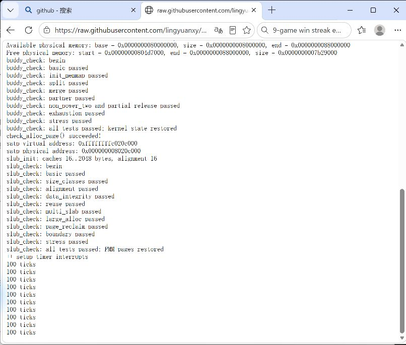
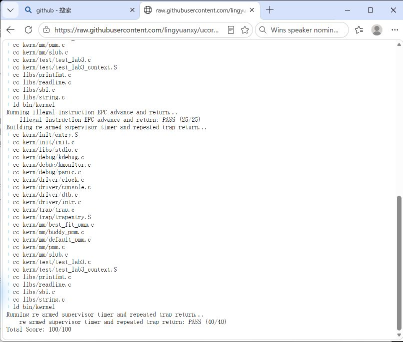

# 操作系统实验报告

## 实验基本信息

| 项目 | 内容 |
| --- | --- |
| **实验名称** | Lab 3：断，都可以断——RISC-V 中断、异常与 Trap 上下文 |
| **小组成员** | 2413170-李孟德、2412075-朱钟铭 |
| **代码完成及验证日期** | 2026-11-06 |
| **报告整理日期** | 2026-11-19 |

### 小组分工

练习如何分工？本表按小组确认的安排整理，李孟德承担主要实现与集成工作。

| 成员 | 负责的练习/模块 |
| --- | --- |
| 2413170-李孟德 | 整体实现与集成；Lab2 内存管理迁移；`RESTORE_ALL`、`__alltraps`、两个 handler 的实现组织；兼容修正、验证结果与排错记录整理 |
| 2412075-朱钟铭 | 配合梳理 Trap 入口、CSR 与特权级变化；分析中断和异常返回逻辑；协助整理模块说明、知识点对应关系和报告校对 |

实验报告如何分工？李孟德负责总体结构、实现规格与提示词、源代码和测试证据对应、排错过程及结果；朱钟铭负责配合补充原理分析、模块关系及总结核对。AI 参与代码生成、命令执行、解释与文字整理。报告区分已保存的运行证据、源码分析和后续改进建议，不把 AI 自动执行的验证写成组员手工单步调试，也不推断未记录的个人操作。

### 已完成任务汇总

| 任务 | 完成情况 | 主要依据 |
| --- | --- | --- |
| Lab2 衔接 | 迁入物理内存初始化、Best Fit、Buddy、SLUB；默认 Buddy，保留 Lab3 中断保护 | `97b5c36`；[迁移验证](validation/lab2-migration/summary.json) |
| Trap 上下文恢复与入口 | 按既有布局恢复现场，将 Trap frame 指针交给 C 函数，执行 `sret` 返回 | [trapentry.S](kern/trap/trapentry.S)；上下文测试 35/35 |
| 中断处理 | 分类、时钟计数、重复设定定时事件、输出十次后关机 | [trap.c](kern/trap/trap.c)；时钟测试 40/40 |
| 异常处理 | 非法指令与断点信息输出，识别 16/32 位长度并推进 EPC，其他异常输出现场 | 非法指令与兜底测试 25/25 |
| 工具链兼容与排错 | `sbadaddr` 改为 `stval`；解决重设定时器时机导致的计数采样问题 | [验证及排错说明](validation/trap/README.md) |

课程助教已明确：旧版 Challenge 注释为历史遗留，本年度无需额外完成。本报告按今年两个正式功能模块组织；其中非法指令、断点处理属于当前必做模块，不因往年称为 Challenge 而省略。

---

## 一、实验目的

1. 理解 RISC-V 中 Trap、中断和异常的关系，区分同步事件与异步事件。
2. 掌握硬件记录 CSR、汇编保存现场、C 函数分发处理、汇编恢复和 `sret` 返回的完整链路。
3. 保证 `SAVE_ALL`、`RESTORE_ALL`、`struct trapframe` 和 RISC-V 调用约定之间一致。
4. 通过持续时钟中断、压缩断点和非法指令验证上下文与返回地址处理。
5. 设计明确的 spec 和 prompt，借助 AI 实现代码，并依据编译与运行证据纠错。

---

## 二、实验环境

你们使用的 AI 工具：

| 成员 | AI 编程工具 | 底层模型 | 备注 |
| --- | --- | --- | --- |
| 2413170-李孟德 | Codex 桌面应用 | GPT-6.1 Sol | 用于源码迁移、代码生成、命令执行、原理解释和报告整理 |
| 2412075-朱钟铭 | Codex | GPT-6.1 Sol | 小组确认的 AI 工具与模型配置，用于辅助原理分析及文字核对 |

工具和模型信息按本次小组确认填写；工具界面名称与底层模型分开记录。

| 项目 | 实际验证环境 |
| --- | --- |
| 开发方式 | Windows、VS Code、WSL Ubuntu |
| 目标架构 | RV64，QEMU virt 单 hart 启动场景 |
| 交叉编译器 | RISC-V GCC 15.1.0，`riscv64-unknown-elf-` 工具链 |
| 模拟器 | QEMU 4.1.1，`/opt/qemu-4.1.1/bin/qemu-system-riscv64` |
| 固件 | 日志记录 OpenSBI v0.4、Runtime SBI Version 0.1 |
| 内核位置 | 原始镜像由 QEMU loader 放到物理地址 `0x80200000` |
| 实验目录 | 仓库 `lab3/`，源码 `kern/`、`libs/`，测试 `tools/` |
| 框架来源 | 本人提供的课程 `lab3.zip`，包内目录为 `lab3_new/` |

此前误把他人已实现的往年仓库作为起点；确认后已通过 `47d8db2` 恢复为课程纯净框架，再迁入本组 Lab2 和实现 Lab3。往年代码仅作审查参考，当前实现及证据以本仓库为准。

---

## 三、实验整体逻辑分析

### 3.1 本章节的逻辑主线

Lab2 解决物理内存如何初始化、分配和释放；Lab3 在此基础上解决“执行流被打断后，如何正确处理事件并回来”。本实验没有实现进程调度，进入 handler 不等于切换到另一个进程。

初始化链路：

```text
kern_entry 设置启动环境与栈
  → kern_init 清零 BSS、读取 DTB、初始化控制台
  → idt_init：sscratch=0，stvec 指向 __alltraps（Direct）
  → pmm_init：使用迁入的 Buddy；SLUB 初始化及自检
  → 再次 idt_init（保留课程框架调用顺序）
  → clock_init：允许时钟中断源，安排首次事件，ticks=0
  → intr_enable：设置 sstatus.SIE
  → 内核循环，等待中断
```

Trap 处理链路：

```text
硬件接受交给 S 态的中断/异常
  → 记录 sepc、scause、stval，更新 sstatus 并跳向 stvec
  → __alltraps / SAVE_ALL：在当前栈上建立 Trap frame
  → a0=sp，call trap
  → trap_dispatch：按 cause 最高位区分中断与异常
  → interrupt_handler 或 exception_handler
  → C 函数返回，顺序进入 __trapret
  → RESTORE_ALL，sret 返回保存的执行位置和特权级
```

硬件不会自动把所有通用寄存器压入本实验的 Trap frame；这由 `SAVE_ALL` 完成。`trap()` 接收的是指针，不是再次构造或复制结构体。

### 3.2 功能的逐步实现

| 顺序 | 功能 | 前后依赖 |
| --- | --- | --- |
| 1 | 恢复正确课程框架，迁移 Lab2 | 提供内核内存管理和已知可用的 Buddy/SLUB 基础 |
| 2 | 检查保存布局与 CSR 名称 | 固定 C/汇编接口，消除 `sbadaddr` 的编译阻塞 |
| 3 | 实现恢复和汇编到 C 的入口 | 先保证处理函数有现场可读、处理后有路径可返回 |
| 4 | 实现中断和异常分支 | 在统一框架里完成具体事件处理和 EPC 更新 |
| 5 | 编译、普通启动及课程评分 | 分别验证功能、关机行为和课程指定测试条件 |
| 6 | 核对日志并修正定时事件重设时机 | 不改评分规则，保留初次失败和最终通过的证据 |

---

## 四、实验内容与实现

### 4.1 前置衔接：迁移本组 Lab2

**负责人：** 2413170-李孟德；朱钟铭配合梳理依赖和说明。

#### 模块功能描述与规格

- 从 `lab2/code/kern/mm/pmm.c` 迁入 `page_init()`：读取 DTB 内存范围、约束可用上限、建立页描述符数组、保留已占用区域并交给 PMM。
- 补齐 Best Fit 的空闲链表、按地址插入辅助函数、初始化、分配、释放、计数和 manager 定义，保留 Lab3 原测试。
- 原样迁入本组 `buddy_pmm.c/.h`、`slub.c/.h`，选择 `pmm_manager = &buddy_pmm_manager`。
- 在 `memlayout.h` 补齐本组实现依赖的物理上限、内核物理起点和虚拟起点宏，保留 Lab3 原子位操作。
- 保留 `alloc_pages/free_pages/nr_free_pages` 已有的中断保存恢复包装，不能用 Lab2 整个 `pmm.c` 覆盖。
- 在开启时钟中断前执行 SLUB 初始化和原自检。Lab2 原目录不修改。

First Fit 的主体与课程已有代码一致，沿用原实现；Lab2 已记录的尾插缺陷未在本轮修改。默认使用 Buddy，不能据此声称 First Fit 的所有边界已验证。

#### 最终提示词

以下提示词依据实际对话约束整理为可复用版本，不冒充逐字导出的原始消息：

```text
将本仓库 lab2/code 中已完成的物理内存初始化、First Fit、
Best Fit、Buddy、SLUB 迁入今年 lab3 纯净框架。
[SPEC] 默认继续使用本组 Buddy；补齐 page_init 及地址常量；
Best Fit 要保留本年度框架自检；SLUB 在开中断前初始化和自检。
[RELY] 复用本组代码和 pmm_manager 接口。
[CONSTRAINT] 不覆盖 Lab3 的中断保护、Trap 待填位置、启动和评分文件；
不修改 Lab2；不要把他人往年实现当作本组完成结果。
[CHECK] 编译内存模块，使用隔离副本验证迁移，并说明它不是 Trap 评分。
```

#### 实现迭代过程

在迁移阶段，内存模块编译通过；因 Trap 尚未实现，独立验证副本临时排除 Trap 入口并运行内存自检。Buddy 在 64、128、256 MiB 配置下，Best Fit 在 128 MiB 下通过 PMM 与 SLUB 自检。256 MiB 配置仍按 Lab2 的 `PHYSICAL_MEMORY_END=0x88000000` 上限管理，并非分配全部 256 MiB。

这些证据见 [迁移摘要](validation/lab2-migration/summary.json)，仅支持内存迁移结论；后续完整 Trap 验证另见第五节。

### 4.2 功能模块一：Trap 上下文恢复与入口

**负责人：** 2413170-李孟德负责实现与集成；2412075-朱钟铭配合 CSR、布局和入口原理分析。

#### 模块功能描述

**需要实现/修改的功能：** 汇编宏 `RESTORE_ALL`、入口标签 `__alltraps`，以及旧 CSR 名称兼容修正。它们不是普通 C 函数。

**SPEC：** 输入为 `SAVE_ALL` 在当前栈上生成的 Trap frame；入口按 ABI 将其指针传给 `void trap(struct trapframe *tf)`；C 返回后恢复原执行状态，最终执行 `sret`。保持结构体、既有保存偏移和 C 函数签名一致，不擅自增加新的现场布局。

RV64 的 Trap frame 为 36 个 8 字节槽位：

| 槽位 | 字节偏移 | 内容 |
| --- | --- | --- |
| 0—31 | 0—248 | `x0`—`x31`；第 2 槽是原 `sp` |
| 32 | 256 | `sstatus`，对应 `tf->status` |
| 33 | 264 | `sepc`，对应 `tf->epc` |
| 34 | 272 | `stval`，字段仍名 `badvaddr` |
| 35 | 280 | `scause`，对应 `tf->cause` |

`sp` 是 `x2` 的别名。先用 `sscratch` 暂存原 `sp`，再将 `sp` 减少 288 字节；原值通过 `s0` 写入第 2 槽。`s0` 就是 `x8`，其原值在作为临时寄存器前已保存到第 8 槽。`STORE s0, 2*REGBYTES(sp)` 的乘法计算的是内存偏移，不是把原 `sp` 的数值乘二。

恢复阶段的关键顺序为：

```asm
LOAD s1, 32*REGBYTES(sp)
LOAD s2, 33*REGBYTES(sp)
csrw sstatus, s1
csrw sepc, s2
# 随后恢复 x1、x3—x31，包括原来的 s1、s2
LOAD x2, 2*REGBYTES(sp)   # 最后恢复原 sp
```

暂用 `s1/s2` 不会丢失原值，因为后续仍按通用寄存器槽位恢复。`x0` 恒零，无需恢复。必须保留当前 `sp` 到最后，否则其他 LOAD 将失去 Trap frame 基址。`scause/stval` 用于诊断和分发，通常无需在返回前还原；它们不是“架构上只读”的寄存器。

入口及返回链路：

```asm
__alltraps:
    SAVE_ALL
    mv a0, sp
    call trap
__trapret:
    RESTORE_ALL
    sret
```

`a0` 是第一个 C 参数寄存器。`call` 写入的 `ra` 不会丢失被中断程序的返回地址，因为原 `x1` 已保存。普通 C 返回先回到 `__trapret`，随后 `sret` 才完成 Trap 返回；不能用普通 `ret` 替代它。

`sret` 将 PC 设为 `sepc`，根据保存的 SPP 决定返回 U 或 S，恢复 SIE 为 SPIE，并将 SPIE 置 1、SPP 清零。本实验时钟处理主要为 S→S；SPP 返回后清零不意味着本次一定返回 U 态。

#### 最终提示词

以下为实际需求与复核意见的结构化整理：

```text
[SPECIFICATION]
依据现有 SAVE_ALL 和 struct trapframe，实现 RESTORE_ALL、__alltraps。
RV64 中按原偏移恢复 sstatus、sepc 及可写通用寄存器，最后恢复 sp；
入口将当前 Trap frame 指针放入 a0，调用 trap，返回后执行恢复与 sret。
[RELY]
REGBYTES、LOAD、STORE，现有 SAVE_ALL、trapframe、trap()、__trapret。
[CONSTRAINT]
不改变结构体和调用接口，不自行假定另一套保存布局。
处理 s0/x8、sp/x2 的别名及特殊保存方式。
当前汇编器不识别 sbadaddr，兼容为 stval，保存槽位不变。
[CHECK]
先展示代码解释，确认后写入，编译并运行原课程上下文与断点测试。
```

#### 实现迭代过程

**已发现的问题：** 迁移后完整构建报告 `Error: unknown CSR 'sbadaddr'`。这是框架使用旧名称与当前汇编器不兼容，不是缺少一个普通 C 变量。

**处理策略：** 将 `csrr s3, sbadaddr` 改为 `csrr s3, stval`。CSR 仍通过临时通用寄存器写入原槽位，结构体无需改名或重排。除此以外按保存布局补齐恢复及调用。

**结果：** 当前实现通过课程上下文恢复和断点返回测试，35/35；记录中没有该汇编模块的第二种功能实现，不虚构多轮生成次数。正式源码为 [trapentry.S](kern/trap/trapentry.S)。

### 4.3 功能模块二：中断与异常处理

**负责人：** 2413170-李孟德负责 handler 实现、验证与时序修正；2412075-朱钟铭配合原因分类、异常返回及报告分析。

#### 模块功能描述

**需要实现的函数：**

```c
void interrupt_handler(struct trapframe *tf);
void exception_handler(struct trapframe *tf);
```

**SPEC——中断：** 从 `cause` 中提取原因编号；S 态时钟每次递增 `ticks`，每 `TICK_NUM=100` 次调用 `print_ticks()`，打印达到 `SHUTDOWN_AFTER=10` 后调用 `sbi_shutdown()`。持续重设下一次事件，时钟不推进 EPC。其他中断输出类型，未知中断还输出原因编号和 Trap frame。

`trap_dispatch()` 已先按最高位分发。handler 使用指针宽度无符号掩码清除最高位：

```c
const uintptr_t interrupt_bit =
    (uintptr_t)1 << (sizeof(uintptr_t) * 8 - 1);
const uintptr_t cause = tf->cause & ~interrupt_bit;
```

该表达式只计算局部 `cause`，不改变 `tf->cause`。RV64 最高位是中断标志，例如 `0x8000000000000005` 提取为时钟编号 5。先转为 `uintptr_t` 避免使用窄的有符号整数字面量进行大位数移位。

`static size_t printed` 在多次调用间保留打印计数；若改成每次重新初始化的局部变量，将无法累计十次。S 态软件中断分支清除 `sip.SSIP` 后输出提示。外部设备分支目前只分类打印，不能据此声称实现了设备控制器的领取、完成或完整驱动。

`clock_set_next_event()` 经 `sbi_set_timer(get_cycles()+timebase)` 安排单次事件，必须重复设置。当前 QEMU 时间基准为 10 MHz，`timebase=100000` 对应理想 10 ms；`rdtime` 读取时间基准，不等于 CPU 指令数。

**SPEC——异常：** 非法指令与断点输出原因和完整宽度地址，识别指令长度后更新 `tf->epc`，避免同一条指令不断重触发。其他异常输出现场，不假装已恢复。

核心处理为：

```c
const uint16_t instruction =
    *(const volatile uint16_t *)(tf->epc);
if ((instruction & 0x3U) != 0x3U) {
    instruction_length = 2;
} else if ((instruction & 0x1fU) != 0x1fU) {
    instruction_length = 4;
} else {
    /* 输出 Trap frame，并 panic，拒绝猜测更长编码的长度。 */
}
tf->epc += instruction_length;
```

`tf->epc` 是内存中保存的返回地址，之后由 `RESTORE_ALL` 写回 `sepc`，`sret` 才使用它。课程断点可能被汇编为 2 字节 `c.ebreak`，不能固定加 4；非法指令测试 `.word 0x0000007b` 为 4 字节。本实现支持本实验中的 16/32 位长度，不是完整的可变长指令解码器。

输出使用 `Breakpoint at`、`Illegal instruction at`、`Unknown interrupt: cause 15` 等课程测试所匹配的字符串。地址使用 `%016lx` 并转换为 `unsigned long`；没有改写原 `print_trapframe()`。后者仍以 `%08x` 输出部分 `uintptr_t` 字段，RV64 高位可能丢失，是遗留诊断格式限制，不能把这类截短日志误解为完整地址。

#### 最终提示词

以下提示词按实际需求整理，非逐字原始对话：

```text
[SPECIFICATION]
在 trap.c 规定位置实现 interrupt_handler 和 exception_handler。
时钟逐次计数，每100次输出，累计10行后 SBI 关机，并重复安排定时事件。
中断不推进 EPC；非法指令和断点按16/32位指令长度推进 EPC。
其他异常打印现场，未知中断输出编号和现场，格式匹配原课程测试。
[RELY]
trapframe、IRQ/CAUSE 宏、ticks、print_ticks、clock_set_next_event、
print_trapframe、libs/sbi.h 中的 sbi_shutdown。
[CONSTRAINT]
保留函数签名、trap_dispatch、课程测试与评分规则。
不把制造非法指令的 mret 塞进正常读时钟路径，不固定 epc+=4。
声明取指仅针对本实验映射且可读的内核代码，长编码不能猜测长度。
[CHECK]
先给代码供审阅，再写文件；实际构建、运行和评分。
如果未通过，解释原始日志，修复实现而不是伪造输出或修改评分规则。
```

#### 实现迭代过程

可核对的 handler 集成验证分为初版和一次时序修正，不把它写成多轮无记录的模型试验。

**第一次集成：** 完整编译成功；上下文 35/35、非法指令及兜底 25/25；普通镜像打印十行并关机。时钟用例自身输出 PASS，但计数为 `ticks=201`，而原评分脚本额外要求字符串 `ticks=200`，因此总分为 60/100。

**问题分析：** 初版在打印前设置下一次定时事件。串口输出有开销，下一次截止时间可能在处理结束前已到，返回后立即再次处理中断，使测试在读取计数时观察到 201。它既反映处理时序，也暴露了测试对瞬时精确采样值的依赖，不能只凭这个计数否定持续中断功能。

**修正策略：** 将重设定时事件移到当前计数和打印之后，减少返回前下一次事件已经到期的情况。没有添加凑 `ticks=200` 的假输出，没有改测试匹配条件。

**第二次验证：** 原课程三项测试为 35/35、25/25、40/40，总分 100/100；普通启动再次输出十行并正常关机。该相对定时方式会将处理开销计入实际周期，不能当作精密的无漂移时钟；任意宿主调度条件下的瞬时计数也不由一次通过证明。

初次及最终证据分别见 [初次评分](validation/trap/initial-grade.txt)、[初次时钟](validation/trap/initial-timer.txt)、[最终评分](validation/trap/grade.txt) 和 [最终时钟](validation/trap/timer.txt)。

### 4.4 练习关联原理与适用边界

- `sstatus.SIE` 是 S 态执行时的中断使能，不是“正在处理中断”标志；`sie` 控制独立来源。U 态执行时，SIE 不用于禁止 S 态中断，但来源使能、挂起及委托等条件仍有效。
- 硬件进入 S 态 Trap 时保存旧 SIE 到 SPIE、清零 SIE，并记录原特权级到 SPP。本实验 handler 未主动开 SIE，默认不嵌套普通 S 态中断；同步异常和更高特权级事件不能简单按同一开关理解。
- 当前入口利用当前栈保存现场，没有依据 `sscratch` 实现完整的用户栈到内核栈切换。不能把相关注释解释成硬件自动切栈。
- 设置定时器时，S 态经 `ecall` 请求 M 态 OpenSBI；之后交给内核的时钟中断通常为 S→S。Trap 和特权级变化均不等于进程切换。
- `local_intr_save/restore` 恢复原来的中断状态，不能在内层临界区结束时无条件开中断；关闭本地中断也不等于多核互斥。

### Challenge：本年度不另行完成

按助教更新，旧版 Challenge 不作为本次额外任务。当前指导书已纳入的非法指令、断点处理仍已实现；本组 Lab2 的 SLUB 是继承代码，不把它计为本次新完成的 Challenge。

---

## 五、测试与验证

### 5.1 命令与测试方式

在仓库根目录的 WSL 终端执行：

```bash
export PATH="/home/lingyuan/riscv-elf-toolchains/bin:/opt/qemu-4.1.1/bin:$PATH"
make -C lab3
make -C lab3 qemu
make -C lab3 grade
```

路径为本机配置，其他机器应调整。普通 QEMU 若需提前退出，按 Ctrl+A，松开后按小写 x。

2026-11-06 的已记录评分实际执行方式是：复制正式源码到隔离目录，运行原 `tools/inject.py` 注入测试，再执行原 `tools/grade.sh`；对应 `make grade` 的核心步骤。未把测试注入正式源文件。原工具的 SHA-256 与实现源文件哈希均保存在 [摘要](validation/trap/summary.json)。本报告整理时核对这些记录与当前文件，不把历史验证写成 11 月 19 日重新运行。

### 5.2 结果与原始证据

| 证据 | 检查内容 | 实测结果 |
| --- | --- | --- |
| [E01：构建输出](validation/trap/build.txt) | 编译、汇编、链接、生成镜像 | 成功 |
| [E02：普通启动](validation/trap/normal.txt) | PMM、SLUB、时钟输出、关机 | 十行 `100 ticks`；已记录退出码 0 |
| [E03：上下文与断点](validation/trap/context.txt) | 多个寄存器保持、压缩断点返回 | 35/35 |
| [E04：非法指令和兜底](validation/trap/illegal.txt) | 4 字节非法指令返回、软件中断、未知中断及未知异常输出 | 25/25 |
| [E05：持续时钟](validation/trap/timer.txt) | 重复进入与返回、达到 200 ticks | 40/40，`ticks=200` |
| [E06：完整评分](validation/trap/grade.txt) | 原脚本三项合计 | 100/100 |
| [E07：初次失败](validation/trap/initial-grade.txt) | 保留真实排错证据 | 60/100；时钟采样为 201 |

### 5.3 测试截图

下图为报告整理时查看已提交原始日志的截图，运行数据来自 2026-11-06，截图补录于 2026-11-19。它们不是当天新执行命令的终端实拍；完整日志与结果依据为上表链接，不以截图代替原始记录。





### 5.4 验证范围与限制

已覆盖当前框架所需的内核态整数现场、16 位断点、32 位非法指令、原因分发、持续时钟和正常关机。未完成用户态完整入口与安全取指、多核与中断优先级抢占、浮点/向量现场保存、实际设备中断驱动、缺页恢复和进程调度。对其他异常只打印后返回，故障持续时仍可能重复触发。

100/100 说明通过这一组课程检查，不等价于穷尽所有寄存器组合、指令编码、宿主调度时序和异常场景。First Fit 既有缺陷和原诊断格式限制也没有因本次评分消失。

---

## 六、实验总结与收获

### 6.1 对操作系统的理解

| 实验知识点 | 对应 OS 原理 | 联系与差异 |
| --- | --- | --- |
| `stvec` 与统一入口 | 控制权接管、受控入口 | 软件预置入口，由硬件接受事件后跳转；本实验 Direct，不是 x86 IDT 机制 |
| `SAVE_ALL`/`RESTORE_ALL` | 上下文保护 | C 与汇编遵守共同布局；本实验现场仅覆盖所列寄存器，不是完整进程调度上下文 |
| `scause` 分发 | 异步中断与同步异常 | 时钟独立于当前指令，非法指令/断点/ecall 由指令触发；异常不一定表示程序错误 |
| EPC 和 `sret` | 精确恢复执行与权限 | 中断通常保持 EPC，实验指定的断点/非法指令按长度跳过；真实缺页恢复可能重试原指令 |
| SBI 定时器 | 固件与内核分层 | 内核在 S 态，OpenSBI 在 M 态；请求设置定时器和随后接收时钟中断是不同事件 |
| `local_intr_save/restore` | 临界区与并发 | 保留先前状态，防止单核中断交错；不能替代多核锁或同步原语 |
| `volatile ticks` | 编译器可见性 | 轮询代码需要观察异步变化；volatile 不保证复合操作原子，也不提供多核同步 |

本次学习中特别澄清了三个混淆：Trap 不是进程切换；SIE 不是当前是否处于中断的编码；`sp` 与 `x2` 是同一个寄存器，而 Trap frame 保存的是其被打断前的值。

### 6.2 重要但本实验未实现的知识点

1. 用户态进程、系统调用表、参数检查以及用户栈/内核栈安全切换。
2. 调度算法、时间片和真正的进程上下文切换。
3. 中断控制器的优先级、领取与完成、多级抢占及安全嵌套。
4. 多核锁、原子操作、内存顺序和跨核中断。
5. 缺页恢复、按需分配、写时复制，以及异常后的重试或进程终止策略。
6. 中断下半部、延迟处理及避免在中断上下文阻塞的工程设计。

### 6.3 AI 协作开发的经验

**规格先于代码。** Prompt 需要同时描述输入输出、依赖接口、保存偏移、允许修改范围及验收方式。只要求“实现中断”容易遗漏 sp 恢复顺序、指令长度或定时器重设。

**参考实现需要核对版本。** 往年仓库含已完成答案、旧 Challenge、不同输出约定乃至构建错误。应先确认课程纯净框架，不将参考报告直接当成本组报告。

**生成代码不等于完成学习。** 通过逐行解释、改错推演和问答，核对宏展开、GPR/CSR 区别、Trap frame 构造、静态计数、按位掩码以及特权级返回。遇到概念不清时，应回到对应指令及其操作对象。

**保留真实失败。** 本次记录兼容错误和 60→100 的时序修正；评分结果与实际功能分别分析，不通过改脚本或添加假输出掩盖问题。报告中的提示词明确标为整理稿，个人操作、模型次数和未发生的 GDB 过程不虚构。

## 参考资料与附件

- [报告模板](../lab1/实验报告模板.md)。
- [课程 Lab3 练习页](http://oslab.mobisys.top/lab2026/_book/lab3/lab3_2_1_exercise.html)：本次开发期间已依据用户保存的完整 HTML 阅读；年度任务以助教更新及课程框架为准。
- [正式代码：trapentry.S](kern/trap/trapentry.S)、[trap.c](kern/trap/trap.c)、[trap.h](kern/trap/trap.h)、[clock.c](kern/driver/clock.c)。
- [Trap 验证与原始日志](validation/trap/README.md)、[Lab2 迁移记录](validation/lab2-migration/summary.json)。
- [本组 Lab2 报告](../lab2/实验报告.md)、[往年参考审查](../reviews/lab3-reference-review.md)。
- 实现提交 `38456b4`；当前报告在此后的独立提交中补充，不改写历史验证日期。
