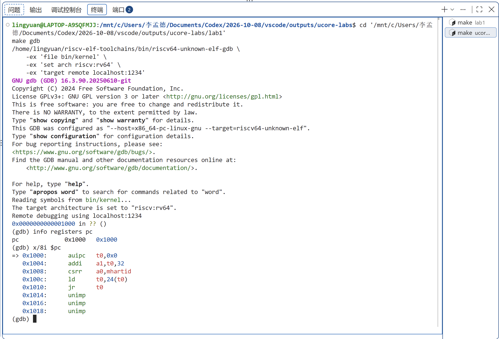
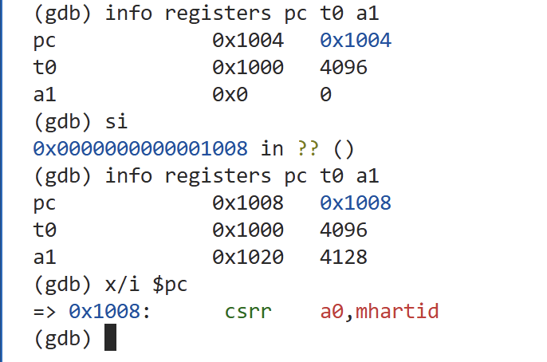
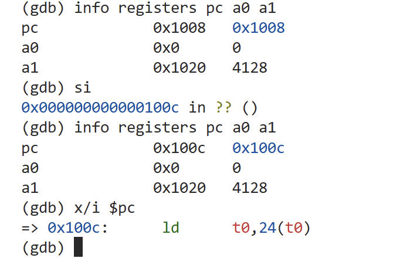
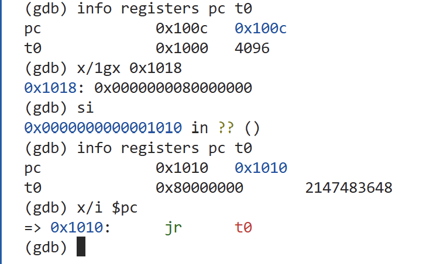
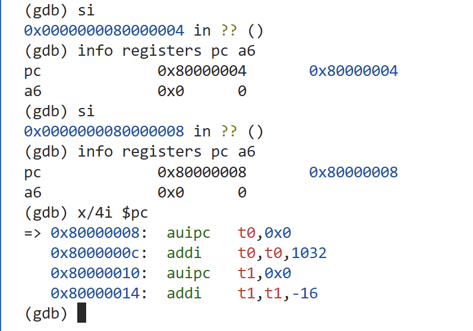
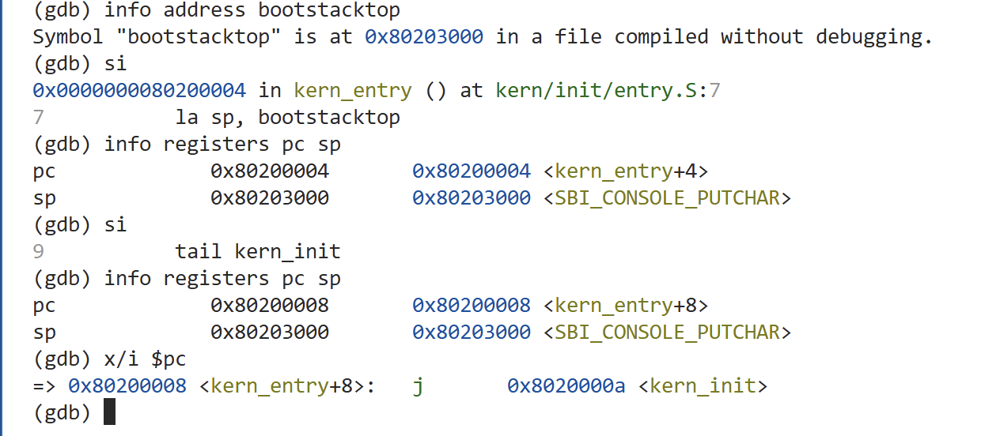
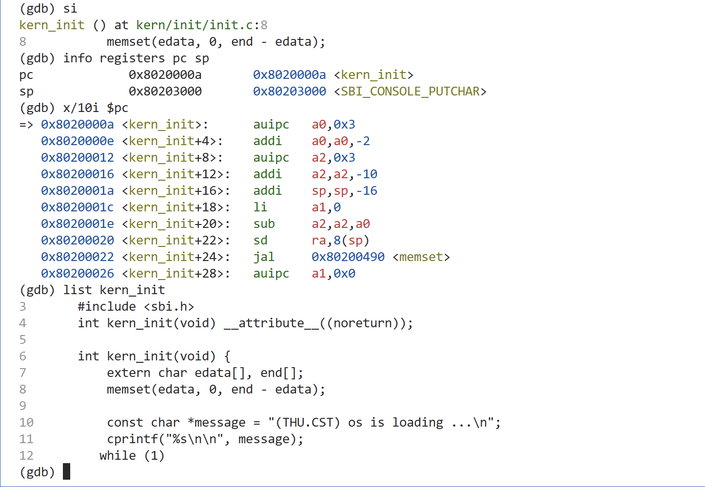
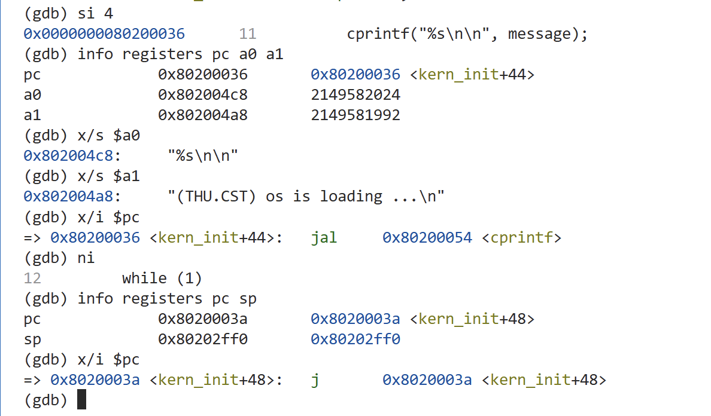

> 早期历史稿，仅供过程追溯。正式报告见 [lab1/实验报告.md](../../lab1/实验报告.md)。

# 操作系统实验报告

> 根据官网任务书核对后的个人完成版见 [lab1/实验报告.md](../../lab1/实验报告.md)。本文件保留早期过程草稿。

> 根据本人实际操作与截图整理，实验观察已完成。成员、分工及模型名称按要求保留待填写；技术结论区分直接调试证据与源码分析。

## 实验基本信息

| 项目 | 内容 |
| --- | --- |
| **实验名称** | Lab 1：RISC-V 上电启动流程观察（名称待按正式任务书核对） |
| **小组成员** | 待填写学号与姓名 |
| **完成日期** | 2026-10-10 |

### 小组分工

| 成员 | 实验操作与报告分工 |
| --- | --- |
| 待填写 | 待按实际分工填写 |

## 一、实验目的

1. 使用 QEMU 4.1.1 模拟 RISC-V 计算机，理解交叉编译与模拟运行的关系。
2. 使用 GDB 观察程序计数器、寄存器及汇编指令，追踪复位入口、OpenSBI 与内核入口之间的控制流。
3. 理解链接地址、内核加载地址、启动栈和 C 入口初始化在启动过程中的作用。
4. 保存实际操作证据与 AI 交互过程，并能够独立解释观察结果。

依据已提供的课程纪要，实验一没有强制编程任务，重点是 GDB 调试与启动流程分析；具体练习标题与提交要求待结合正式任务书核对。

## 二、实验环境

以下为本次使用的环境，编译器、QEMU、GDB 和固件版本已由本人操作截图核对。

| 项目 | 配置 |
| --- | --- |
| 开发方式 | Windows VS Code + WSL2 Ubuntu |
| WSL 系统 | Ubuntu 26.04，x86_64 |
| RISC-V 编译器 | riscv64-unknown-elf-gcc 15.1.0（本人终端实测） |
| 操作系统实验 QEMU | 4.1.1，路径 `/opt/qemu-4.1.1/bin/qemu-system-riscv64` |
| 固件 | QEMU 4.1.1 自带 OpenSBI v0.4 |
| 调试器 | riscv64-unknown-elf-gdb，GNU GDB 16.3.90.20250610-git（本人终端实测） |
| 实验代码 | 课程提供的 lab1；没有为本实验修改 C/汇编源码 |

QEMU 多版本并存：系统已有新版保留；本实验 Makefile 通过独立路径选择 4.1.1，运行与调试使用课程原来的 `-device loader` 加载参数。

### AI 工具

| 成员 | AI 编程工具 | 底层模型 | 备注 |
| --- | --- | --- | --- |
| 待填写 | Cline（VS Code 插件）；Codex 桌面应用用于引导与报告协作 | 待填写实际使用的模型名称，不以 Plus 套餐名代替模型名 | 本人执行实验命令，AI 解释与辅助整理 |

## 三、实验整体逻辑分析

### 3.1 逻辑主线

本实验关注内核获得控制权之前及刚获得控制权时发生的事情。通过本人实际调试，已经观察到以下启动链条：

```text
复位入口 0x1000 → OpenSBI 0x80000000
→ mret：目标 0x80200000、目标特权级 S
→ 内核汇编入口 kern_entry：设置启动栈
→ C 入口 kern_init 0x8020000a：memset、cprintf
→ 自跳转位置 0x8020003a
```

各阶段的地址和关键寄存器变化已在后文记录。QEMU 终端输出与末尾自跳转单步结果均已实际验证。这里的复位入口地址属于本实验 QEMU virt 平台，不能直接推广为所有 RISC-V 硬件的规定。

### 3.2 观察顺序及其原因

1. 核对模拟器版本并编译：先保证运行环境符合课程要求、生成与源码对应的内核文件。
2. 暂停启动并连接 GDB：避免程序直接运行到末尾，保留观察复位入口的机会。
3. 观察复位入口及跳转：确认 CPU 最初执行的位置以及如何进入固件。
4. 追踪固件到内核的交接：区分固件执行与操作系统内核执行。
5. 分析汇编入口到 C 入口：理解为何要先准备栈，再执行 C 初始化代码。
6. 结合串口输出及最终循环验证启动结果：将控制流观察与外部可见现象对应。

## 四、实验内容与实现

本实验按观察阶段组织。模板中的函数补全、代码生成迭代和 Challenge 项目，只在正式任务书实际要求时填写；不虚构实现任务或测试次数。

### 阶段一：环境核对与内核编译

**负责人：** 待填写。

**本人执行的命令与实际输出：** 已在 VS Code WSL 终端进入 `lab1`，运行版本核对、`make clean` 和 `make`。`make print-qemu` 输出 `/opt/qemu-4.1.1/bin/qemu-system-riscv64`，模拟器版本为 4.1.1，编译器版本为 `riscv64-unknown-elf-gcc (g1b306039ac4) 15.1.0`。

编译输出包含 `+ cc kern/init/entry.S`、`+ cc kern/init/init.c` 等步骤，随后显示 `+ ld bin/kernel`，最后执行：

```text
riscv64-unknown-elf-objcopy bin/kernel --strip-all -O binary bin/ucore.img
```

命令结束后返回 shell 提示符，截图未见编译或链接错误。本步确认编译完成；后续调试和 QEMU 终端截图进一步验证了内核启动。

**原理分析：** 编译、汇编阶段将各源文件转换为目标文件，链接阶段按照链接脚本组织地址并生成 ELF 内核。ELF 文件保留符号及调试信息，供 GDB 将地址对应到源码；`objcopy` 生成原始二进制镜像，供本实验的 QEMU loader 加载。QEMU 版本核对同时检查 Makefile 选择的路径和该路径对应程序的版本，避免把系统默认新版误当作本实验版本。

**工具分工：** 内核同样由 C 和汇编源码构成，需要编译器生成机器指令。交叉编译器在 x86 主机上运行、生成 RISC-V 指令；QEMU 模拟目标机器；GDB 控制目标执行并查看状态。本实验通过 Makefile 指定独立安装的 QEMU 4.1.1，因此同时核对该路径与对应程序的版本，而不是只查询系统默认命令。

### 阶段二：暂停 QEMU 并连接 GDB

**本人执行的命令与实际输出：** 启动调试环境后，在第二个终端执行 `make gdb`。Makefile 实际选择了 `/home/lingyuan/riscv-elf-toolchains/bin/riscv64-unknown-elf-gdb`，读取 `bin/kernel`，设置目标架构为 `riscv:rv64`，连接 `localhost:1234`。终端显示 `Remote debugging using localhost:1234`，随后停在 `0x0000000000001000`。

执行 `info registers pc`，得到 `pc 0x1000 0x1000`。执行 `x/8i $pc`，当前指令为 `auipc t0,0x0`。本阶段完成连接及初始状态观察；后续单步结果记录在阶段三。

**原理分析：** QEMU 模拟目标 CPU，GDB 通过远程调试协议控制和读取目标状态。GDB 启动输出表明宿主为 `x86_64-pc-linux-gnu`，目标为 `riscv64-unknown-elf`，因此调试工具运行在本机，而被观察的指令属于 RISC-V。GDB 读取的内核符号不覆盖复位入口，初始地址显示 `??`，仍可以按地址反汇编。

**调试启动原理：** make debug 的 `-s` 开启 localhost:1234 的 GDB 服务，`-S` 让 CPU 在执行启动指令前暂停，保留初始状态。第一个终端运行 QEMU 并接收模拟串口输出，第二个运行 GDB 并发送调试命令，二者通过远程调试协议连接。

### 阶段三：复位入口到 OpenSBI

**已观察的单步结果：** 本人执行 `info registers pc t0`，记录初始 `pc=0x1000`、`t0=0x0`；随后执行一次 `si`，再次查看寄存器，得到 `pc=0x1004`、`t0=0x1000`。执行 `x/i $pc`，下一条指令为 `addi a1,t0,32`。

| 执行的指令 | 执行前 | 执行后 | 证据 |
| --- | --- | --- | --- |
| `0x1000: auipc t0,0x0` | PC=0x1000，t0=0 | PC=0x1004，t0=0x1000 | 图 3 |
| `0x1004: addi a1,t0,32` | PC=0x1004，t0=0x1000，a1=0 | PC=0x1008，t0=0x1000，a1=0x1020 | 图 4 |
| `0x1008: csrr a0,mhartid` | PC=0x1008，a0=0，a1=0x1020 | PC=0x100c，a0=0，a1=0x1020 | 图 5 |
| `0x100c: ld t0,24(t0)` | PC=0x100c，t0=0x1000；0x1018 的 8 字节内容为 0x80000000 | PC=0x1010，t0=0x80000000 | 图 6 |
| `0x1010: jr t0` | PC=0x1010，t0=0x80000000 | PC=0x80000000，t0=0x80000000，a0=0，a1=0x1020 | 图 7 |

**分析：** `auipc` 将该指令自身的地址与立即数左移 12 位后的偏移量相加，写入目标寄存器。此处立即数为 0，故 `t0=0x1000`；该指令占 4 字节，执行后顺序前进至 `0x1004`。后续指令可以利用 `t0` 作为地址计算的基准。[指令语义依据](https://docs.riscv.org/reference/isa/v20260120/unpriv/rv32.html#_integer_register_immediate_instructions)。

随后本人单步执行 `addi a1,t0,32`，观察到 `a1=0x1020`，即 `0x1000+32`，PC 前进至 `0x1008`，下一条指令为 `csrr a0,mhartid`。已核对 QEMU 4.1.1 的启动源码：设备树紧接 32 字节的复位向量，放在 `0x1020`，这条 addi 用于将设备树地址准备在 a1 中。设备树描述硬件布局，供固件读取；本人的截图确认了地址计算，还未直接查看设备树内容。[QEMU 4.1.1 源码依据](https://github.com/qemu/qemu/blob/v4.1.1/hw/riscv/virt.c#L426)。

接着本人执行 `csrr a0,mhartid`，PC 从 `0x1008` 前进到 `0x100c`，a0 为 0，a1 保持 `0x1020`，下一条指令为 `ld t0,24(t0)`。mhartid 是保存当前 hart 编号的特殊寄存器，本步将编号读取到 a0。a0 前后相同，是因为读取结果与原有值都为 0，不代表指令没有执行。[mhartid 语义依据](https://docs.riscv.org/reference/isa/priv/machine.html)。

本人随后执行 `x/1gx 0x1018`，观察到该位置保存 `0x0000000080000000`。单步执行 `ld t0,24(t0)` 后，t0 从 `0x1000` 变成 `0x80000000`，PC 从 `0x100c` 到 `0x1010`，下一条为 `jr t0`。这验证了基址加偏移的内存读取：先用执行前 t0 计算 `0x1000+24=0x1018`，再将该位置的 8 字节内容写入 t0。读取位置与读出的目标地址是两个不同的值。

最后本人单步执行 `jr t0`，PC 从 `0x1010` 到达 `0x80000000`，t0 仍为 `0x80000000`，a0 为 0，a1 为 `0x1020`。通过 `x/8i $pc` 观察到固件入口第一条指令为 `csrr a6,mhartid`。至此逐条完成复位入口五条指令的观察，确认从复位区域进入默认 OpenSBI 固件的控制流。

QEMU 4.1.1 将默认固件加载到 DRAM 基址 `0x80000000`，内核 loader 将 uCore 镜像放在 `0x80200000`。两处分别对应固件和内核，进入固件不等于已经进入内核。此前把 `0x1018` 按指令反汇编会出现 `unimp`，本次内存查看证实这里包含跳转地址数据；复位指令通过 jr 跳走，不会顺序执行这片数据。

### 阶段四：OpenSBI 到内核入口

**实际停点、PC 和关键指令：** 到达固件入口 `0x80000000` 后观察入口分支，再以硬件断点定位交接指令并单步进入内核。入口附近反汇编如下：

```asm
0x80000000: csrr  a6,mhartid
0x80000004: bgtz  a6,0x80000108
0x80000008: auipc t0,0x0
0x8000000c: addi  t0,t0,1032
0x80000010: auipc t1,0x0
0x80000014: addi  t1,t1,-16
0x80000018: sd    t1,0(t0)
0x8000001c: auipc t0,0x0
```

结合 OpenSBI v0.4 的 `firmware/fw_base.S`，入口先读取 hart 编号，编号为 0 的 hart 继续主启动路径，其余 hart 进入等待重定位完成的路径。[OpenSBI v0.4 启动源码](https://github.com/riscv-software-src/opensbi/blob/v0.4/firmware/fw_base.S)。

**本人已观察的固件入口分支：** 第一次 si 执行 csrr 后，`pc=0x80000004`、`a6=0`；第二次 si 执行 bgtz 后，`pc=0x80000008`、`a6=0`。条件 a6>0 不成立，CPU 顺序执行主启动路径，未跳至 `0x80000108`。下一条为 `auipc t0,0x0`（图 8）。

**已完成的交接前停点观察：** 根据本机 QEMU 4.1.1 配套固件的只读反汇编及 OpenSBI v0.4 的 `sbi_hart_switch_mode` 源码定位 `0x80005036`。本人先用 `x/i` 确认该处为 mret，再设置硬件断点并执行 continue，成功在此指令执行前停止。

| 交接前状态 | 本人实际观察 | 含义 |
| --- | --- | --- |
| PC | 0x80005036 | 当前停在固件的 mret 指令 |
| mepc | 0x80200000 | mret 将采用的内核入口地址 |
| mstatus | 0x8000000000006800，MPP=1 | 已准备将执行后的特权级设为 S 模式 |
| a0 | 0 | 传给内核的 hart 编号 |
| a1 | 0x82200000 | 传给内核的设备树地址 |

mret 依据 mepc 更新 PC，并依据 mstatus.MPP 切换特权级。本人单步执行 mret 后，PC 实际到达 `0x80200000 <kern_entry>`，GDB 显示 `kern/init/entry.S:7` 的 `la sp,bootstacktop`。a0 保持 0，a1 保持 0x82200000，sp 为 0x8001bd80。结合执行前 MPP=1 与 mret 的规则，内核应在 S 模式开始执行。[RISC-V 特权规范依据](https://docs.riscv.org/reference/isa/priv/machine.html)。

**寄存器查看过程中遇到的问题：** 本人在进入内核后读取 mstatus，得到 `Could not fetch register "mstatus"; remote failure reply '14'`。已核对 QEMU 4.1.1 的 gdbstub.c 与 csr.c：调试接口读取 CSR 时仍经过当前特权级检查，S 模式读取 M 模式的 mstatus 会被拒绝。此处是调试器寄存器读取失败；PC、sp、启动参数与入口反汇编均已成功读取。没有取得 mret 执行后的 mstatus 值，后续查看只选择适用的寄存器。[QEMU CSR 访问检查](https://github.com/qemu/qemu/blob/v4.1.1/target/riscv/csr.c)、[调试接口](https://github.com/qemu/qemu/blob/v4.1.1/target/riscv/gdbstub.c)。

此前进入固件时 a1 为 0x1020，本次交接前变成 0x82200000。OpenSBI v0.4 的 QEMU virt 配置指定 `FW_JUMP_FDT_ADDR=0x82200000`，启动汇编包含设备树复制过程。观察到的参数变化与设备树搬移、交给下一阶段的逻辑一致；本实验没有逐条单步观察中间的复制循环。[平台配置](https://github.com/riscv-software-src/opensbi/blob/v0.4/platform/qemu/virt/config.mk)、[搬移源码](https://github.com/riscv-software-src/opensbi/blob/v0.4/firmware/fw_base.S)。

**链接、加载和交接地址必须一致：** 内核链接脚本设置 BASE_ADDRESS=0x80200000，并将 kern_entry 作为入口；QEMU loader 把原始镜像加载到 0x80200000；该固件的 FW_JUMP_ADDR 也配置为 0x80200000，最终写入 mepc。链接确定代码中地址的含义，加载确定机器指令在内存中的位置，交接确定 CPU 开始执行的位置。三者一致，才能正确进入内核；这里进入的是 S 模式操作系统内核。

### 阶段五：汇编入口与 C 初始化

**涉及的现有代码：** `kern_entry` 和 `kern_init`，阅读与观察，未要求补全函数。

**本人观察记录：** 刚到达 kern_entry 时，sp 初值为固件遗留的 0x8001bd80；随后单步完成启动栈设置并进入 C 入口。入口反汇编为：

```asm
0x80200000 <kern_entry>:   auipc sp,0x3
0x80200004 <kern_entry+4>: mv    sp,sp
0x80200008 <kern_entry+8>: j     0x8020000a <kern_init>
```

源码的 `la sp,bootstacktop` 是汇编伪指令，在本次构建中展开为前两条机器指令。本人执行 `info address bootstacktop`，查询到栈顶地址为 `0x80203000`。第一条单步后 PC=0x80200004、sp=0x80203000；第二条单步后 PC=0x80200008、sp 仍为 0x80203000。由此验证内核 sp 已设为 bootstacktop，下一条为进入 kern_init 的跳转。

源码为启动栈预留两页，即 8192 字节。结合本次构建的符号表，bootstack 位于 0x80201000，bootstacktop 位于 0x80203000，栈使用区间为 [0x80201000,0x80203000)，从上边界向低地址增长。

截图中 sp 的注释显示 `<SBI_CONSOLE_PUTCHAR>`。构建符号表表明它与 bootstacktop 同为 0x80203000：bootstacktop 是栈区域结束处的边界标签，SBI_CONSOLE_PUTCHAR 是紧接其后的数据对象。GDB 选择同地址符号作注释，不改变寄存器数值或启动栈的含义。`info address` 的“without debugging”提示针对该标签的调试信息，地址查询已经成功，源码行和指令单步也正常。

**本人已观察的 C 入口：** 单步执行 `j 0x8020000a` 后，PC=0x8020000a，sp=0x80203000；GDB 显示 `kern_init()` 及 init.c 第 8 行的 memset。此源码行定位表示当前指令对应该行，不代表整行调用已经执行完毕。入口反汇编包括准备 a0、a2 地址、sp 减 16、a1 置零、计算 a2 差值、保存 ra，以及 `0x80200022: jal 0x80200490 <memset>`（图 12）。

**C 初始化的逻辑：** 清零链接脚本中 edata 到 end 的区间，打印启动文字，最终停在无限循环。edata 与 end 是链接脚本定义的地址符号，在 C 中用 extern 声明引用。

**本人已核对的清零范围与参数：** info address 分别查询 edata 和 end，两个地址同为 `0x80203008`。本人从 C 入口执行 si 8 后，PC 停在 `0x80200022` 的 jal memset 之前，sp=0x80202ff0，a0=0x80203008，a1=0，a2=0（图 13）。三个参数分别对应清零起始地址、填充值与字节数，和源码一致。

本次最小内核的 BSS 清零区间为空，因此没有需要清零的字节；保留这一启动初始化代码可以适应后续含 BSS 数据的内核。报告不将本次零长度调用描述为已清零非空内存。sp 相比启动栈顶减去 16，形成调用栈帧；调用前的 sd ra,8(sp) 将返回地址寄存器值保存到栈。

**本人已观察的调用与返回：** 执行 jal 后 PC=0x80200490，进入 memset；ra=0x80200026，a0=0x80203008，a1=0，a2=0。入口第一条为 `beqz a2,0x802004a0`，零长度参数选择直接返回路径。执行 finish 后回到 kern_init，PC=0x80200026、sp=0x80202ff0，返回值为 `(void *)0x80203008`，符合 memset 返回起始地址的行为（图 14）。

**优化调试中的变量显示：** GDB 在 memset 中把源码变量 n 显示为 18446744073709551615。源码使用 `while(n-- > 0)`，n 是 64 位无符号 size_t。已只读检查本次 ELF 的 DWARF：在入口附近，n 的位置表达式为 `DW_OP_breg12(a2): -1; DW_OP_stack_value`，即按 a2-1 重建源码变量，得到 2^64-1。真实传入的长度由 a2=0 和调用前边界差值共同确认；入口机器指令直接判断 a2 为零。优化后的源码变量显示不能直接替代寄存器与控制流证据。[GDB 优化代码说明](https://sourceware.org/gdb/current/onlinedocs/gdb.html/Optimized-Code.html)。

**本人已观察的打印调用与末尾位置：** 从 0x80200026 执行四条指令后，停在 `0x80200036: jal 0x80200054 <cprintf>`。a0=0x802004c8，`x/s` 显示格式串 `%s\n\n`；a1=0x802004a8，显示启动文字 `(THU.CST) os is loading ...\n`。执行 ni 后调用返回，PC=0x8020003a，sp=0x80202ff0，当前指令为 `j 0x8020003a`（图 15）。QEMU 终端实际出现 `(THU.CST) os is loading ...`，与消息内容一致（图 17）。

**打印原理（源码分析，未逐条单步内部实现）：** cprintf 通过 vcprintf、vprintfmt 格式化字符串，再经 cputch、cons_putc 和 sbi_console_putchar 逐字符请求 SBI 服务。当前实现用 ecall 进入固件的服务处理，再返回内核。因此 OpenSBI 进入内核后仍为内核提供底层服务。

**末尾循环原理与验证：** 本次最小内核暂未继续执行调度或用户程序，源码使用 while(1) 保持在内核中。本人在 0x8020003a 执行一次 si 后，PC 仍为 0x8020003a，反汇编仍为跳到自身的指令（图 16）。这是预期的忙循环，kern_init 不会返回。GDB 每次单步后都会暂停；若继续运行，CPU 将重复执行该跳转。

### AI 协作过程

本次采用“AI 给出一步指导和原理解释 → 本人执行 → 回传实际截图 → 核对结果并修正报告”的协作方式。源码分析和调试证据分开记录，未进行函数代码生成或实验 C/汇编修改。

**本阶段原始指导请求：**

```text
现在我要开始进行这个实验的要求以及撰写实验报告了，实验报告模板给你了，注意这个实验你只需要引导我操作，实验要求的步骤我需要完成操作，并且我需要你给我解释原理，有的地方没让我操作但是我需要知道为什么这么做，然后跟我一起撰写报告
```

逐条操作命令和对应截图见 [实验操作记录](实验操作记录.md)。[完整公开对话记录](AI交互记录（实验操作阶段）.md) 收录本阶段 56 条用户与助手公开消息，并配套 17 张实际截图，范围截至最后验证截图。下表为交互摘要，摘要不替代完整记录。

| 轮次 | 实际提问 | 回答要点 | 本人操作与结果 | 修正或理解变化 |
| --- | --- | --- | --- | --- |
| 1 | 请求 AI 逐步引导实验、解释原理，并共同撰写报告；询问如何在 VS Code 中打开 Ubuntu 项目 | 使用 WSL 模式打开已有项目，先核对版本并重新编译 | 本人执行版本核对、make clean、make，返回截图；QEMU 为 4.1.1，编译完成 | 按实测将报告中的 GCC 版本由预填的 14.2.0 修正为 15.1.0；区分编译完成与启动验证 |
| 2 | 完成 GDB 连接与初始状态查看后询问：为什么操作系统实验会出现 GCC 编译器？ | 内核由 C 和汇编源码构成，需要编译工具生成机器指令；区分 GCC 的构建作用、QEMU 的执行作用和 GDB 的调试作用 | 本人截图显示 GDB 已连接 localhost:1234，初始 PC 为 0x1000，已反汇编入口附近内容 | 实际调试器为工具链自带 GDB，修正环境记录；后续单步操作暂停，先澄清工具分工 |
| 3 | 询问接下来如何操作，并返回第一条指令单步截图 | 使用 si 执行一条指令，比较执行前后的 PC 与 t0 | 本人观察到 PC 从 0x1000 到 0x1004，t0 从 0 到 0x1000 | 验证 auipc 的地址计算效果；下一条待执行指令为 addi a1,t0,32 |
| 4 | 返回第二条指令执行前后的截图 | addi 将 t0 与十进制 32 相加，准备设备树地址 | 本人观察到 a1 从 0 到 0x1020，PC 从 0x1004 到 0x1008，t0 不变 | 地址计算与预期相符；下一条待执行指令为 csrr a0,mhartid |
| 5 | 返回第三条指令执行前后的截图 | csrr 将 mhartid 保存的硬件执行单元编号读到 a0，作为启动参数 | 本人观察到 PC 从 0x1008 到 0x100c，a0 为 0，a1 保持 0x1020 | 读取结果恰好与原值相同；结合 PC 前进确认完成单步 |
| 6 | 返回内存查看与第四条指令执行前后的截图 | ld 用 t0 加 24 计算读取位置，从内存加载 8 字节到 t0 | 本人观察到 0x1018 保存 0x80000000，执行后 t0=0x80000000、PC=0x1010 | 区分读取位置和读取内容；目标已加载，实际跳转待下一步验证 |
| 7 | 返回执行 jr 后的寄存器与固件入口反汇编截图 | jr 按 t0 指定地址跳转，固件地址与内核地址分属两个启动阶段 | 本人观察到 PC=0x80000000、a0=0、a1=0x1020，入口指令为 csrr a6,mhartid | 确认复位入口到 OpenSBI 的控制流，准备观察固件启动分支 |
| 8 | 返回固件入口两条指令的单步结果 | 读取 hart 编号后，bgtz 按 a6 是否大于 0 选择路径 | 两次停点分别为 0x80000004 和 0x80000008，a6=0 | 确认当前 hart 顺序进入主启动路径；后续计划以断点观察内核交接 |
| 9 | 返回交接前断点及寄存器截图 | 以硬件断点观察 mret 前状态，结合 mepc 与 MPP 分析目标地址和特权级 | 本人停在 0x80005036，mepc=0x80200000，MPP=1，a0=0，a1=0x82200000 | 确认固件准备进入 S 模式内核；设备树地址变化结合源码解释，实际 mret 待执行 |
| 10 | 返回执行 mret 后的内核入口截图，含 mstatus 读取错误 | 根据 PC 与符号确认交接，核对旧版 QEMU 调试 CSR 的特权检查，并开始分析启动栈 | 本人 PC 到达 0x80200000，显示 kern_entry；sp=0x8001bd80，a0=0，a1=0x82200000；mstatus 无法读取 | 根据源码解释调试读取限制，后续不再读取该 M 模式 CSR；准备单步执行 la sp,bootstacktop |
| 11 | 返回栈顶地址查询及两条启动栈指令的单步截图 | la 伪指令展开为 auipc 与零偏移的 mv，设置内核自身的 sp | 本人确认 bootstacktop=0x80203000，两条单步后 sp=0x80203000、PC=0x80200008 | 栈指针与符号地址一致；结合符号表解释同地址的 SBI_CONSOLE_PUTCHAR 注释 |
| 12 | 返回进入 kern_init 后的寄存器、反汇编与 C 源码截图 | 将源码中的 memset 与参数准备、栈帧和 jal 调用指令对应起来 | 本人 PC=0x8020000a、sp=0x80203000，看到 init.c 第 8 行及 jal memset | 已进入 C 入口；下一步核对清零范围与参数，尚未将整行 memset 标为完成 |
| 13 | 返回 edata/end 查询与调用前参数截图 | 根据起止地址判断清零长度，通过 a0/a1/a2 核对三个参数，观察栈帧分配 | 两个边界同为 0x80203008；PC=0x80200022，sp=0x80202ff0，a0=0x80203008、a1=0、a2=0 | 确认本次清零区间为空，记录实际零长度情况，随后验证函数调用和返回 |
| 14 | 返回进入 memset 与 finish 返回的截图，包含源码变量 n 的巨大显示值 | 结合返回地址、a2、入口分支和 DWARF 核对调用行为，解释优化后 n-- 的逻辑值 | ra=0x80200026，a2=0，finish 回到该地址，返回指针 0x80203008 | 确认零长度调用正常返回；源码变量显示按 a2-1 重建，不能当作真实入参 |
| 15 | 返回 cprintf 参数、ni 返回及末尾指令截图 | x/s 核对格式串和启动文字，ni 运行调用至返回，将 while(1) 与自跳转对应 | a0=0x802004c8、a1=0x802004a8；调用后 PC=0x8020003a、sp=0x80202ff0，指令跳向自身 | 已定位启动末尾；待补充 QEMU 实际输出及自跳转单步证据 |
| 16 | 返回自跳转单步与 QEMU 启动输出截图；要求报告个人信息先空着 | 单步验证 PC 不变，并把终端实际输出与打印参数对应 | PC 保持 0x8020003a；QEMU 显示 OpenSBI v0.4 和内核启动文字 | 实验启动观察与证据收集完成，成员、分工和模型名称保留待填 |

## 五、测试与验证

| 观察项目 | 本人实际结果 | 证据 |
| --- | --- | --- |
| QEMU 版本与 Makefile 选择 | 路径为 `/opt/qemu-4.1.1/bin/qemu-system-riscv64`，版本为 4.1.1 | 图 1 |
| 内核编译 | 完成编译、链接及 objcopy 镜像生成，返回 shell 提示符 | 图 1 |
| GDB 连接与初始 PC | 连接 localhost:1234 成功，PC 为 0x1000 | 图 2 |
| 第一条复位指令单步 | 执行 auipc 后 PC=0x1004，t0=0x1000 | 图 3 |
| 第二条复位指令单步 | 执行 addi 后 PC=0x1008，a1=0x1020，t0 不变 | 图 4 |
| 第三条复位指令单步 | 执行 csrr 后 PC=0x100c，a0=0，a1=0x1020 | 图 5 |
| 第四条复位指令单步 | 0x1018 保存 0x80000000；执行 ld 后 t0=0x80000000、PC=0x1010 | 图 6 |
| 复位入口到固件 | 逐条执行五条复位指令，最终 PC=0x80000000，进入 OpenSBI | 图 3 至图 7 |
| 固件入口条件分支 | a6=0，bgtz 未跳转，PC 到达 0x80000008 | 图 8 |
| 内核交接前断点 | 停在 mret，mepc=0x80200000，MPP=1，a1=0x82200000 | 图 9 |
| 固件到内核入口 | 单步执行 mret 后 PC=0x80200000，显示 kern_entry 源码与符号 | 图 9、图 10 |
| 启动栈设置 | bootstacktop=0x80203000，两条单步后 sp 与其一致，PC=0x80200008 | 图 11 |
| 汇编入口到 C 入口 | 单步后 PC=0x8020000a，显示 kern_init，sp=0x80203000 | 图 12 |
| memset 调用前范围与参数 | edata=end=0x80203008，a0=该地址，a1=0，a2=0，sp=0x80202ff0 | 图 13 |
| memset 调用与返回 | PC=0x80200490、ra=0x80200026；finish 后 PC=0x80200026，返回起始指针 | 图 14 |
| cprintf 参数与返回 | 格式串和消息内容正确，ni 后返回 0x8020003a，sp=0x80202ff0 | 图 15 |
| 最终自跳转位置 | 执行一次 si 后 PC 仍为 0x8020003a，指令仍跳向自身 | 图 16 |
| QEMU 终端启动文字 | 实际出现 OpenSBI v0.4、Current Hart=0、Firmware Base=0x80000000 和内核启动文字 | 图 17 |

本次验证包括本人编译、GDB 单步与断点观察、函数调用检查及 QEMU 实际启动输出。原始 lab1 包没有 tools/grade.sh，本次实验操作未运行 make grade，也不把已有证据描述为评分脚本通过。

**图 1：本人进行版本核对与内核编译的终端截图。**


**图 2：本人连接 GDB 并查看初始 PC 和入口反汇编。**



**图 3：第一条指令执行前后的 PC 与 t0。**


**图 4：第二条指令执行前后的 PC、t0 与 a1。**



**图 5：第三条指令读取 hart 编号后的状态。**



**图 6：内存中的跳转目标及 ld 加载后的状态。**



**图 7：jr 跳转至 OpenSBI 入口及入口附近反汇编。**


**图 8：OpenSBI 读取 hart 编号并选择主启动路径。**



**图 9：OpenSBI 执行 mret 前的目标地址、目标特权级与启动参数。**


**图 10：mret 后进入内核，以及旧版 QEMU 下的 mstatus 调试读取限制。**


**图 11：查询启动栈顶，并单步验证 sp 的设置。**



**图 12：进入 kern_init，查看 C 源码及 memset 调用前的指令。**



**图 13：BSS 区间边界、memset 参数与调用栈帧。**


**图 14：memset 的调用、参数、入口分支与正常返回。**


**图 15：cprintf 的格式串、启动消息、调用返回及最终自跳转指令。**



**图 16：单步执行自跳转后，PC 保持不变。**


**图 17：QEMU 终端中的 OpenSBI 启动信息与内核实际输出。**


## 六、实验总结与收获

### 对操作系统的理解

| 知识点 | 本实验的具体观察 | 与操作系统原理的关系 |
| --- | --- | --- |
| 启动控制流与程序计数器 | 0x1000 经 jr 进入 0x80000000，固件经 mret 进入 0x80200000 | 内核获得控制权之前，需要已有启动代码建立执行环境；PC 的变化提供控制流证据 |
| 特权级与固件服务 | 交接前 MPP=1，mret 后进入内核；打印源码通过 ecall 请求 SBI | 内核运行于 S 模式，固件运行于 M 模式；硬件特权级与底层服务接口体现分工 |
| 链接、加载与入口地址 | 链接脚本、loader 参数和 mepc 共同指向 0x80200000 | 可执行文件布局、内存中的加载位置与 CPU 执行入口必须协调；本实验尚未建立复杂虚拟地址空间 |
| 启动栈与函数调用 | sp 设为 bootstacktop，进入 C 函数后减 16，jal 设置 ra，memset 返回到 ra 指定位置 | 栈和调用约定支持 C 函数执行；这里是单一内核启动栈，尚未涉及多任务栈与上下文切换 |
| 静态存储初始化 | edata=end，a2=0，零长度 memset 正常返回 | 启动代码承担 BSS 零初始化；本次最小内核实际区间为空，不能据此声称清零了非空区域 |
| 调试证据与外部输出 | 寄存器、反汇编、函数返回和 QEMU 启动文字相互对应 | 应根据实际证据确认运行行为，区分源码显示、优化后变量显示与硬件状态 |

本实验尚未实现进程调度、系统调用到用户进程的完整路径、页表与虚拟内存管理、文件系统或并发同步。当前观察到的固件入口与内核入口切换，也不等同于用户进程的上下文切换。此处的 ecall 用于内核向 SBI 请求服务，不能直接当作用户程序向内核发起系统调用。

### AI 协作开发的经验

本次协作中的有效方法，是每次只完成一个可验证的阶段，再根据截图解释寄存器和指令，而不是先填写预期结论。报告中的 GCC 版本由最初预填的 14.2.0 修正为本人实测的 15.1.0，说明环境记录也应以实际输出为准。

出现 mstatus 读取失败时，结合当前特权级和 QEMU 4.1.1 源码定位了调试接口限制，保留错误及解释，继续使用可读寄存器。出现 memset 中 n 的巨大显示值时，结合参数寄存器、入口分支与 DWARF 核对真实零长度调用，避免只凭一个源码变量显示判断程序行为。

AI 提供步骤、源码解释和报告整理，本人完成编译、GDB 操作及截图。固件设备树搬移和打印内部路径通过源码分析说明，报告未把这些过程写成逐条单步完成。个人理解与收获的措辞可在复习后进一步用自己的话调整。
